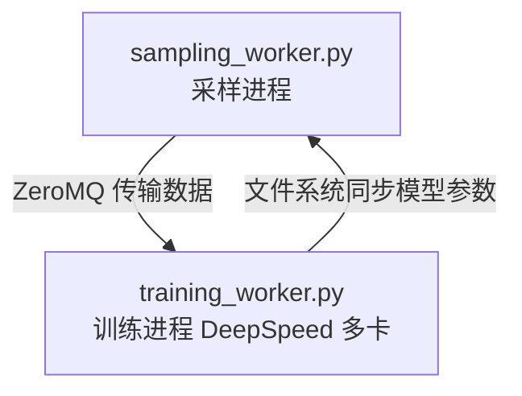
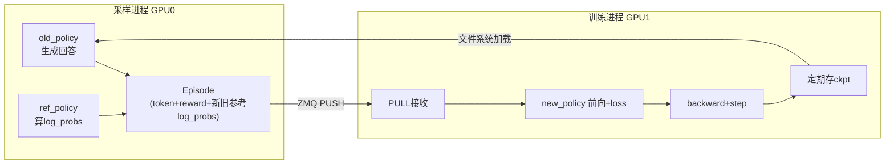
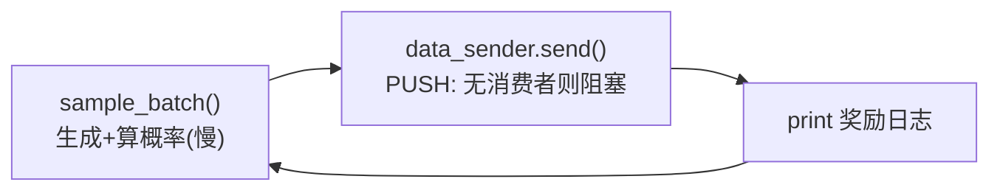
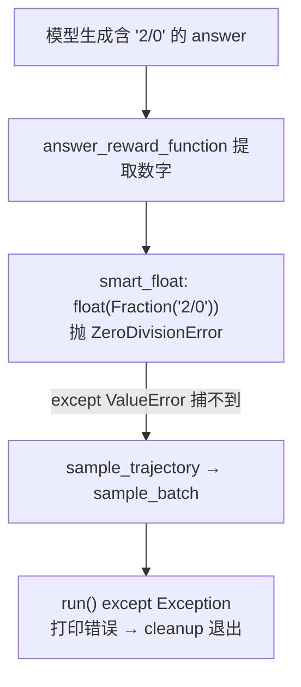

# 工作记录
# DeepWiki Q&A with Code Context for Repository: g29times/grpo_vs_gspo
## Q1
项目整体中文介绍，以及告知更适合拉到本地IDE复现还是云端colab。（对话使用中文）
### Answer
## 结论

这是一个在 GSM8K 数据集上对比 **GRPO 与 GSPO** 两种 RLHF 算法的分布式微调项目，采用「采样进程 + DeepSpeed 多卡训练进程」双进程架构。 grpo_vs_gspo:1-11  **建议拉到本地（或具备多卡的GPU服务器）复现，不适合 Colab** —— 官方配置使用 3 张 vGPU-32G（2 卡训练 + 1 卡采样），Colab 单卡环境无法运行其分布式架构。 grpo_vs_gspo:115-119 

---

## 项目介绍

### 核心目标
- 对 `Qwen2.5-1.5B-Instruct` 在 GSM8K 上做全量/LoRA 微调，完整复现 GRPO 和 GSPO，包括旧策略采样、参考策略采样、新策略训练三个阶段。 grpo_vs_gspo:1-2 
- GSPO 的关键区别是**序列级重要性采样**（几何均值），与序列级 reward 颗粒度对齐，方差更小、收敛更快；GRPO 是 token 级重要性采样。 grpo_vs_gspo:50-62 

### 架构

- 采样进程：旧策略轨迹采样 + 旧/新策略概率分布推理。 grpo_vs_gspo:7-11 
- 训练进程：`training_worker.py` 中 `TrainingWorker` 类通过 ZMQ 接收数据，DeepSpeed fork 多个 rank 做分布式训练，支持 LoRA 显存优化。 grpo_vs_gspo:24-67 
- 算法切换在 `config.yaml` 的 `training.use_gspo` 字段。 grpo_vs_gspo:146-154 

### 训练效果
GSPO 约 50 步收敛，GRPO 约 120 步收敛，最终答案准确率均约 0.6。 grpo_vs_gspo:122-126 

## 复现方式对比

| | 本地/多卡GPU服务器 ✅ | Colab ❌ |
|---|---|---|
| GPU需求 | 推荐3卡（2训练+1采样） | 免费/Pro 通常仅单卡 |
| DeepSpeed 多进程 | `deepspeed --num_gpus=2` 原生支持 grpo_vs_gspo:156-169  | 多进程ZMQ+文件同步可行，但单卡需大改配置 |
| 分布式后端 | 注意 vGPU 环境需用 `gloo` 而非 `nccl` grpo_vs_gspo:172-176  | Colab 上同样受限 |

如果只有单卡，理论上可以改 `num_gpus=1` 并共用一张卡跑，但 1.5B 模型训练+采样同卡会有显存压力和串行化开销。

## Notes
- 项目参考了 GRPO-Zero 和 simple_GRPO 的实现思路。 grpo_vs_gspo:191-196 
- 关键坑：训练前向需开 Gradient Checkpointing 防 OOM；LoRA 建议更大学习率（2e-4）。 grpo_vs_gspo:177-178 

Wiki pages you might want to explore:
- [Overview (g29times/grpo_vs_gspo)](/wiki/g29times/grpo_vs_gspo#1)
### Citations
**File:** README.md (L1-11)
```markdown
# GRPO vs GSPO
本项目使用deepseek grpo和qwen gspo方法对qwen2.5-1.5B-Instruct模型在GSM8K数据集上的全量微调, 完整地复现了[GRPO算法](https://arxiv.org/pdf/2402.03300)和[GSPO算法](https://arxiv.org/pdf/2507.18071)进行对比, 包括旧策略采样、参考策略采样和新策略训练. 本项中搭建的分布式训练框架适合off policy方法与deepspeed结合进行LLM分布式微调.

## 训练框架


项目主要分为采样进程和训练进程:
* 采样进程: 旧策略轨迹采样 + 旧策略概率分布推理 + 新策略的概率分布推理
* 训练进程: deepspeed自动fork多个子进程Rank_n, 各子进程中进行数据分割及分布式训练
* 训练数据传递: 采样进程->训练进程, 用zmq实现
* 模型参数同步: 训练进程->采样进程, 用文件系统实现
```
**File:** README.md (L50-62)
```markdown
## GSPO算法原理
GSPO算法是Qwen团队最新提出的RLHF算法, 在GRPO算法基础上进行改进, 设计动机是为了解决GRPO算法序列级别的reward与token级别的重要性采样值颗粒度不对齐导致的不稳定性问题. GSPO算法的改进点为把重要性采样部分调整为序列级别. 带来了两点优势:
* 降低token方差, 训练过程更为稳定, 用几何均值计算序列重要性采样, 能够有效缩小token的方差, 使训练过程更加稳定.
* 对于MoE架构模型, 不再需要routing replay, 因为序列重要性天然包含对专家路由的边缘积分, 专家路由与生成模型的联合概率分布变为边缘概率分布, 可以直接进行重要性采样.

$$
J_{GSPO}(\theta)=E\left[\frac{1}{G} \sum_{i=1}^G \min \left(s_i(\theta) \hat{A}_i, \text{clip}\left(s_i(\theta), 1-\epsilon, 1+\epsilon\right) \hat{A}_i\right)\right]
$$
$$
s_i(\theta)=\left(\frac{\pi_\theta\left(y_i \mid x\right)}{\pi_{\theta_{\text {old }}}\left(y_i \mid x\right)}\right)^{\frac{1}{\left|y_i\right|}}=\exp \left(\frac{1}{\left|y_i\right|} \sum_{t=1}^{\left|y_i\right|} \log \frac{\pi_\theta\left(y_{i, t} \mid x, y_{i,<t}\right)}{\pi_{\theta_{\text {old }}}\left(y_{i, t} \mid x, y_{i,<t}\right)}\right)
$$

其中$s_i(\theta)$表示序列重要性采样, 与序列组内回报$\hat{A}_i$颗粒度是对齐的.
```
**File:** README.md (L115-119)
```markdown
* 参考模型: qwen2.5-1.5B-Instruct
* 目标模型: qwen2.5-1.5B-Instruct
* 硬件配置: 3 × AutoDL vGPU-32G (GPU0/1用于训练, GPU2用于采样)
* 训练步数: 200 steps (60min)

```
**File:** README.md (L122-126)
```markdown

* GSPO算法在50个训练步左右基本稳定并到达峰值, 答案准确率为0.6左右, 格式准确率为0.99左右
* GRPO算法在120个训练步左右基本稳定并到达峰值, 答案准确率为0.6左右, 格式准确率为0.99左右

从结果来看GSPO训练速度明显优于GRPO, 消耗更少的时间达到稳定状态. 从模型特性来解释, GSPO模型训练时方差更小, 在矫正输出分布时有更强的确定性能够快速调整, 宏观上体现为更快得收敛至稳定值. 训练至200步后两种方法训练的结果基本接近, 应该是达到模型极限.
```
**File:** README.md (L146-154)
```markdown
```python
# config.yaml
# 用grpo算法训练
training:
  use_gspo: false
# 用gspo算法训练
training:
  use_gspo: true
```
```
**File:** README.md (L156-169)
```markdown
```bash
# 依赖安装
pip install -r requirements.txt
# GSM8K数据集下载
git clone https://huggingface.co/datasets/openai/gsm8k
# Qwen2.5-1.5B-Instruct模型下载(huggingface)
git clone https://huggingface.co/Qwen/Qwen2.5-1.5B-Instruct
# Qwen2.5-1.5B-Instruct模型下载(modelscope)
git clone https://www.modelscope.cn/Qwen/Qwen2.5-1.5B-Instruct.git
# 启动采样进程
python sampling_worker.py
# 启动训练进程
CUDA_VISIBLE_DEVICES=0,1 deepspeed --num_gpus=2 training_worker.py
```
```
**File:** README.md (L172-176)
```markdown
* 工程上实现的生成序列包含人为填充的pad token, 需要将pad token去掉计算有效序列的概率分布, 防止引入无意义的概率噪声.
* AutoDL vGPU进行分布式训练时后台通信不能用默认的nccl, 需要改为gloo, nccl仅支持物理GPU的通信.
* off policy方法涉及到旧策略、新策略等多个模型, 通常采样与训练分布不同进程中, 采样数据传输到训练进程后需要手动进行数据并行, 给deepspeed fork的各子进程手动分配数据, 否则会造成单卡数据过多且重复.
* 从训练进程同步模型参数至采样进程时仅在主进程中传递即可, 否则会重复传递造成资源浪费.
* LLM进行RLHF训练微调时若需要同步模型参数, 可以用文件系统实现. LLM通常参数量较大, 若用网络传递速度较慢且容易失败.
```
**File:** README.md (L177-178)
```markdown
* 在训练模式下前向传播时显存占用过高, 显存占用会出现一个尖峰, 非常容易OOM, 解决方法是在加载模型时开启Gradient Checkpoint `model.gradient_checkpointing_enable()`. 具体表现如下图所示, 开启前峰值显存约为17GB左右, 开启后5GB左右, 有效地防止了OOM的现象, 同时也允许更大的batch_size.
* LoRA微调时需要更大的步长, 比如: 2e-4. 用LoRA训练时参数被约束在一个低秩子空间, 在受限的空间中找到最优解相对于全量微调需要更多的迭代步骤, 因此可以考虑更大的步长加快收敛.
```
**File:** README.md (L191-196)
```markdown
## 参考资料
本项目基于以下优秀项目实现, 在此进行感谢
* [GRPO论文](https://arxiv.org/pdf/2402.03300) 提供了理论基础, 组内相对奖励的设计极大的减少了训练开销.
* [GSPO论文](https://arxiv.org/pdf/2507.18071) 提供了理论基础, 序列重要性采样与序列reward进行颗粒度对齐稳定了训练过程并提升训练效率.
* [GRPO-Zero](https://github.com/policy-gradient/GRPO-Zero) 用清晰的代码逻辑实现了GRPO方法, 并且手搓transformer网络、qwen模型结构和AdamW, 是一份非常优秀的示例代码.
* [simple_GRPO](https://github.com/lsdefine/simple_GRPO) 提供了采样-训练双进程实现的思路, 并且以非常简介的形式复现了GRPO方法.
```
**File:** training_worker.py (L24-67)
```python
class TrainingWorker:
    def __init__(self, config: dict):
        dtype_map = {
            "bfloat16": torch.bfloat16,
            "float16": torch.float16,
            "float32": torch.float32,
        }

        self.gpu_id = config["gpu"]["training_gpu"]
        self.pretrained_model_path = config["model"]["pretrained_model_path"]
        self.ref_model_path = config["model"]["ref_model_path"]
        self.dtype = dtype_map.get(config["model"]["dtype"], torch.bfloat16)
        self.data_path = config["data"]["data_path"]
        self.max_gen_len = config["data"]["max_gen_len"]
        self.train_batch_size = config["data"]["train_batch_size"]
        self.sample_batch_size = config["data"]["sample_batch_size"]
        self.test_size = config["data"]["test_size"]
        self.test_batch_size = config["data"]["test_batch_size"]
        self.data_path = config["data"]["data_path"]
        self.num_answers_per_question = config["data"]["num_answers_per_question"]
        self.num_questions_per_batch = self.train_batch_size // self.num_answers_per_question
        self.use_gspo = config["training"]["use_gspo"]
        self.eval_interval = config["training"]["eval_interval"]
        self.sync_interval = config["training"]["sync_interval"]
        self.zmq_data_port = config["communication"]["data_port"]
        self.ds_config_path = config["deepspeed"]["config_path"]
        self.ckpt_dir = Path(config["checkpoint"]["ckpt_dir"])
        self.ckpt_file = config["checkpoint"]["ckpt_file"]
        self.use_lora = config["lora"]["enabled"]
        self.lora_rank = config["lora"]["rank"]
        self.lora_alpha = config["lora"]["alpha"]
        self.lora_lr = float(config["lora"]["learning_rate"])
        self.lora_dropoutp = config["lora"]["dropout"]
        self.lora_adapter_dir = Path(config["lora"]["adapter_dir"])
        self.ckpt_dir.mkdir(parents=True, exist_ok=True)
        self.lora_adapter_dir.mkdir(parents=True, exist_ok=True)

        # DeepSpeed多进程相关属性
        self.rank = 0
        self.world_size = 1
        self.is_main_process = True

        self.setup_model()
        self.setup_zmq()
```
## Q2
6卡nvidia A10 是否支持
### Answer
**完全支持，而且绰绰有余。** 项目官方配置只需 3 张 32G 卡（2 训练 + 1 采样），6 张 A10（单卡 24GB）显存和卡数都足够，甚至可以扩大训练规模。 grpo_vs_gspo:115-119 

---

## 需要修改的配置

`config.yaml` 中 GPU 分配是显式指定的： grpo_vs_gspo:37-40 

```yaml
gpu:
  sampling_gpu: 5        # 例如用第6张卡采样
  training_gpu: [0, 1]   # 可扩展为 [0,1,2,3] 用4卡训练
```

启动命令相应改为 `deepspeed --num_gpus=4` 等。 grpo_vs_gspo:166-168 

## 关键注意点

### 1. 数据并行约束
`broadcast_episodes` 按 `world_size` 切分问题数，要求 `sample_questions_per_batch % world_size == 0`，代码中有断言检查。例如 4 卡训练时需保证 `sample_batch_size / num_answers_per_question` 能被 4 整除。 grpo_vs_gspo:207-213 grpo_vs_gspo:355-357 

### 2. 通信后端可换回 NCCL（可选优化）
代码硬编码 `gloo`，是因为 AutoDL vGPU 不支持 NCCL；A10 是物理 GPU，可把 `training_worker.py` 中 `dist.init_process_group(backend='gloo')` 改为 `'nccl'` 获得更快通信。 grpo_vs_gspo:100-100 grpo_vs_gspo:173-173 

### 3. 显存占用
开启 Gradient Checkpointing 后训练峰值约 5GB，A10 的 24GB 非常宽裕，可以增大 `train_batch_size` / `sample_batch_size` 加速训练。 grpo_vs_gspo:177-177 grpo_vs_gspo:14-17 

## Notes
- 采样进程是单卡单进程（`cuda:{sampling_gpu}`），多余卡无法自动用于采样加速。 grpo_vs_gspo:46-46 
- DeepSpeed 用 ZeRO-2 + CPU offload，多卡时显存压力进一步降低。 grpo_vs_gspo:13-24 

Wiki pages you might want to explore:
- [Workers and Runtime (g29times/grpo_vs_gspo)](/wiki/g29times/grpo_vs_gspo#3)
- [Glossary (g29times/grpo_vs_gspo)](/wiki/g29times/grpo_vs_gspo#6)
### Citations
**File:** README.md (L115-119)
```markdown
* 参考模型: qwen2.5-1.5B-Instruct
* 目标模型: qwen2.5-1.5B-Instruct
* 硬件配置: 3 × AutoDL vGPU-32G (GPU0/1用于训练, GPU2用于采样)
* 训练步数: 200 steps (60min)

```
**File:** README.md (L166-168)
```markdown
python sampling_worker.py
# 启动训练进程
CUDA_VISIBLE_DEVICES=0,1 deepspeed --num_gpus=2 training_worker.py
```
**File:** README.md (L173-173)
```markdown
* AutoDL vGPU进行分布式训练时后台通信不能用默认的nccl, 需要改为gloo, nccl仅支持物理GPU的通信.
```
**File:** README.md (L177-177)
```markdown
* 在训练模式下前向传播时显存占用过高, 显存占用会出现一个尖峰, 非常容易OOM, 解决方法是在加载模型时开启Gradient Checkpoint `model.gradient_checkpointing_enable()`. 具体表现如下图所示, 开启前峰值显存约为17GB左右, 开启后5GB左右, 有效地防止了OOM的现象, 同时也允许更大的batch_size.
```
**File:** config.yaml (L14-17)
```yaml
  sample_batch_size: 8 # 采样批次大小
  train_batch_size: 4  # 单进程训练批次大小
  test_batch_size: 20  # 评估批次大小
  num_answers_per_question: 4 # 每个问题组内采样数量
```
**File:** config.yaml (L37-40)
```yaml
# GPU配置
gpu:
  sampling_gpu: 2      # 采样进程使用的GPU
  training_gpu: [0, 1]  # 训练进程使用的GPU列表
```
**File:** training_worker.py (L100-100)
```python
        dist.init_process_group(backend='gloo')  # autodl的vgpu没法用nccl通信, 需要设置为gloo
```
**File:** training_worker.py (L207-213)
```python
            # 不同的rank分割episodes
            sample_batch_size = len(episodes)
            sample_questions_per_batch = sample_batch_size // self.num_answers_per_question
            num_questions_per_rank = sample_questions_per_batch // self.world_size
            num_data_per_rank = num_questions_per_rank * self.num_answers_per_question

            episodes_per_rank = episodes[self.rank*num_data_per_rank : self.rank*num_data_per_rank+num_data_per_rank]
```
**File:** training_worker.py (L355-357)
```python
                            assert sample_batch_size % self.num_answers_per_question == 0 # 检查sample_batch_size是否能被num_answers_per_question整除
                            sample_questions_per_batch = sample_batch_size // self.num_answers_per_question
                            assert sample_questions_per_batch % self.world_size == 0 # 检查sample_questions_per_batch是否能被world_size整除
```
**File:** sampling_worker.py (L46-46)
```python
        self.device = torch.device(f'cuda:{self.gpu_id}' if torch.cuda.is_available() else 'cpu')
```
**File:** ds_config.json (L13-24)
```json
    "zero_optimization": {
        "stage": 2,
        "allgather_partitions": true,
        "allgather_bucket_size": 2e8,
        "overlap_comm": true,
        "reduce_scatter": true,
        "reduce_bucket_size": 2e8,
        "contiguous_gradients": true,
        "stage3_gather_16bit_weights_on_model_save": true,
        "offload_optimizer": {
            "device": "cpu"
        }
```
## Q3
deepspeed是什么 是一个需要独立安装的推理框架吗
### Answer
**DeepSpeed 不是推理框架，而是微软开源的分布式「训练」优化库**，以普通 Python 包的形式通过 `pip install -r requirements.txt` 安装即可，无需单独部署服务。 grpo_vs_gspo:156-169 

---

## 在本项目中的角色

它只出现在训练进程 `training_worker.py` 中，负责两件事：

### 1. 启动多进程（launcher）
`deepspeed --num_gpus=2 training_worker.py` 会自动 fork 出多个子进程，每个子进程对应一个 rank 和一张 GPU。 grpo_vs_gspo:7-11 grpo_vs_gspo:166-168 

### 2. 包装模型做分布式训练（引擎）
代码中 `import deepspeed` 后调用 `deepspeed.initialize`，把普通的 PyTorch 模型包装成 `model_engine`，之后反向传播和参数更新都走 `model_engine.backward(loss)` / `model_engine.step()`，梯度跨卡同步由它自动完成。 grpo_vs_gspo:20-20 grpo_vs_gspo:127-135 grpo_vs_gspo:262-265 

## 它提供的核心能力：ZeRO

`ds_config.json` 配置了 **ZeRO Stage 2** + 优化器状态 CPU offload —— 把梯度、优化器状态切分到多张卡上，降低单卡显存占用，这是 DeepSpeed 最出名的功能。 grpo_vs_gspo:13-24 

| 常见误解 | 实际情况 |
|---|---|
| 是推理框架（如 vLLM）？ | ❌ 本项目采样推理由 `sampling_worker.py` 里的 transformers 模型直接完成，不用 DeepSpeed |
| 需要独立安装部署？ | ❌ 就是个 pip 包，`import deepspeed` 即用 |
| 和 PyTorch 关系？ | 构建在 `torch.distributed` 之上，代码中 `dist.init_process_group` 就是底层通信初始化 grpo_vs_gspo:100-100  |

## Notes
- DeepSpeed 也提供推理加速功能（DeepSpeed-Inference），但本项目只用到了训练侧（ZeRO + launcher）。
- 配置文件路径在 `config.yaml` 的 `deepspeed.config_path` 字段指定。 grpo_vs_gspo:33-35 

Wiki pages you might want to explore:
- [Overview (g29times/grpo_vs_gspo)](/wiki/g29times/grpo_vs_gspo#1)
- [Glossary (g29times/grpo_vs_gspo)](/wiki/g29times/grpo_vs_gspo#6)
### Citations
**File:** README.md (L7-11)
```markdown
项目主要分为采样进程和训练进程:
* 采样进程: 旧策略轨迹采样 + 旧策略概率分布推理 + 新策略的概率分布推理
* 训练进程: deepspeed自动fork多个子进程Rank_n, 各子进程中进行数据分割及分布式训练
* 训练数据传递: 采样进程->训练进程, 用zmq实现
* 模型参数同步: 训练进程->采样进程, 用文件系统实现
```
**File:** README.md (L156-169)
```markdown
```bash
# 依赖安装
pip install -r requirements.txt
# GSM8K数据集下载
git clone https://huggingface.co/datasets/openai/gsm8k
# Qwen2.5-1.5B-Instruct模型下载(huggingface)
git clone https://huggingface.co/Qwen/Qwen2.5-1.5B-Instruct
# Qwen2.5-1.5B-Instruct模型下载(modelscope)
git clone https://www.modelscope.cn/Qwen/Qwen2.5-1.5B-Instruct.git
# 启动采样进程
python sampling_worker.py
# 启动训练进程
CUDA_VISIBLE_DEVICES=0,1 deepspeed --num_gpus=2 training_worker.py
```
```
**File:** training_worker.py (L20-20)
```python
import deepspeed
```
**File:** training_worker.py (L100-100)
```python
        dist.init_process_group(backend='gloo')  # autodl的vgpu没法用nccl通信, 需要设置为gloo
```
**File:** training_worker.py (L127-135)
```python
        # 初始化DeepSpeed引擎
        self.model_engine, self.optimizer, _, self.scheduler = deepspeed.initialize(
            model=self.new_policy_model,
            model_parameters=model_parameters,
            config=ds_config
        )

        self.device=self.model_engine.device
        print(f"DeepSpeed初始化完成，世界大小: {self.model_engine.world_size}")
```
**File:** training_worker.py (L262-265)
```python
        # 反向传播和优化步骤
        self.model_engine.backward(loss)
        self.model_engine.step()

```
**File:** ds_config.json (L13-24)
```json
    "zero_optimization": {
        "stage": 2,
        "allgather_partitions": true,
        "allgather_bucket_size": 2e8,
        "overlap_comm": true,
        "reduce_scatter": true,
        "reduce_bucket_size": 2e8,
        "contiguous_gradients": true,
        "stage3_gather_16bit_weights_on_model_save": true,
        "offload_optimizer": {
            "device": "cpu"
        }
```
**File:** config.yaml (L33-35)
```yaml
# DeepSpeed配置
deepspeed:
  config_path: "./ds_config.json"
```
## Q4
在具备上述硬件及 python 环境 的 linux上，其他前置环境准备是什么？还是 仅 pip install 就可以开干了？
### Answer
**不是光 `pip install` 就能跑** —— 除了装 Python 依赖，还需要：NVIDIA 驱动/CUDA 环境、下载模型权重和 GSM8K 数据集（需 `git`/`git-lfs`）、按你的 6 卡改 `config.yaml`。 grpo_vs_gspo:156-169 

---

## 完整前置清单

### 1. 系统层（pip 之外）
- **NVIDIA 驱动 + CUDA**：`torch` 需能调用 A10，`nvidia-smi` 应可见 6 卡；本项目用 `bf16`，A10 原生支持。 grpo_vs_gspo:7-7 
- **git / git-lfs**：模型和数据集都用 `git clone` 从 HuggingFace/ModelScope 拉取，大文件需要 LFS。 grpo_vs_gspo:159-164 

### 2. Python 依赖
```bash
pip install -r requirements.txt
```
包含 `torch`、`transformers`、`deepspeed`、`peft`、`pyzmq` 等；`pyzmq` 若编译安装可能需要系统 `libzmq` 开发包（多数情况 wheel 可直接装）。 grpo_vs_gspo:1-12 

### 3. 下载资产（放项目根目录，路径与 `config.yaml` 对应）
```bash
git clone https://huggingface.co/datasets/openai/gsm8k          # → ./gsm8k
git clone https://huggingface.co/Qwen/Qwen2.5-1.5B-Instruct     # → ./Qwen2.5-1.5B-Instruct
```
路径对应 `config.yaml` 的 `data.data_path` 和 `model.pretrained_model_path`，放别处需改配置。 grpo_vs_gspo:3-11 

### 4. 针对你的 6×A10 改配置
```yaml
gpu:
  sampling_gpu: 5
  training_gpu: [0, 1]   # 或扩展更多卡
``` grpo_vs_gspo:37-40 

### 5. 一处代码修改（建议）
A10 是物理 GPU，可把 `training_worker.py` 的 `backend='gloo'` 改为 `'nccl'`（不改也能跑，gloo 只是慢）。 grpo_vs_gspo:100-100 

## 启动顺序
```bash
python sampling_worker.py                                    # 终端1
CUDA_VISIBLE_DEVICES=0,1 deepspeed --num_gpus=2 training_worker.py  # 终端2
```
两个进程通过本地 ZMQ 端口 5555 通信，无需额外网络配置。 grpo_vs_gspo:165-168 grpo_vs_gspo:28-31 

## Notes
- `ds_config.json` 开了 optimizer CPU offload，需保证有足够内存（1.5B 模型开销很小）。 grpo_vs_gspo:22-24 
- `checkpoints/`、`lora_adapter/` 目录代码会自动创建，无需手动建。 grpo_vs_gspo:58-59 

Wiki pages you might want to explore:
- [Getting Started (g29times/grpo_vs_gspo)](/wiki/g29times/grpo_vs_gspo#1.1)
- [Glossary (g29times/grpo_vs_gspo)](/wiki/g29times/grpo_vs_gspo#6)
### Citations
**File:** README.md (L156-169)
```markdown
```bash
# 依赖安装
pip install -r requirements.txt
# GSM8K数据集下载
git clone https://huggingface.co/datasets/openai/gsm8k
# Qwen2.5-1.5B-Instruct模型下载(huggingface)
git clone https://huggingface.co/Qwen/Qwen2.5-1.5B-Instruct
# Qwen2.5-1.5B-Instruct模型下载(modelscope)
git clone https://www.modelscope.cn/Qwen/Qwen2.5-1.5B-Instruct.git
# 启动采样进程
python sampling_worker.py
# 启动训练进程
CUDA_VISIBLE_DEVICES=0,1 deepspeed --num_gpus=2 training_worker.py
```
```
**File:** config.yaml (L3-11)
```yaml
# 模型配置
model:
  ref_model_path: "./Qwen2.5-1.5B-Instruct"
  pretrained_model_path: "./Qwen2.5-1.5B-Instruct"
  dtype: "bfloat16"

# 数据配置
data:
  data_path: "./gsm8k"
```
**File:** config.yaml (L28-31)
```yaml
# ZeroMQ通信配置
communication:
  data_port: 5555      # 训练数据传输端口
  timeout: 100         # 通信超时时间（毫秒）
```
**File:** config.yaml (L37-40)
```yaml
# GPU配置
gpu:
  sampling_gpu: 2      # 采样进程使用的GPU
  training_gpu: [0, 1]  # 训练进程使用的GPU列表
```
**File:** requirements.txt (L1-12)
```text
bottle
math-verify
safetensors
sentencepiece
tokenizers
torch
tornado
transformers
deepspeed
peft
pyzmq
pandas
```
**File:** training_worker.py (L58-59)
```python
        self.ckpt_dir.mkdir(parents=True, exist_ok=True)
        self.lora_adapter_dir.mkdir(parents=True, exist_ok=True)
```
**File:** training_worker.py (L100-100)
```python
        dist.init_process_group(backend='gloo')  # autodl的vgpu没法用nccl通信, 需要设置为gloo
```
**File:** ds_config.json (L22-24)
```json
        "offload_optimizer": {
            "device": "cpu"
        }
```
## Q5
显卡使用现状（别的服务占用）需要分析一下并匀一些资源出来 （本项目做多用3张卡）
```
+-----------------------------------------------------------------------------------------+
| Processes:                                                                              |
|  GPU   GI   CI              PID   Type   Process name                        GPU Memory |
|        ID   ID                                                               Usage      |
|=========================================================================================|
|    0   N/A  N/A           54744      C   ...ma.cpp/build/bin/llama-server      18008MiB |
|    1   N/A  N/A           54744      C   ...ma.cpp/build/bin/llama-server      17840MiB |
|    2   N/A  N/A         3624256      C   VLLM::Worker_TP0                      20158MiB |
|    3   N/A  N/A         3624257      C   VLLM::Worker_TP1                      20166MiB |
|    4   N/A  N/A         3624258      C   VLLM::Worker_TP2                      20206MiB |
|    5   N/A  N/A         3624259      C   VLLM::Worker_TP3                      20198MiB |
+-----------------------------------------------------------------------------------------+
```
### Answer
## 结论

当前 6 张卡全被占用，每卡只剩约 **4~6GB**，不满足本项目「训练每卡 ~5GB + 采样卡需放两个 1.5B 模型 ~6GB」的需求，**建议停掉一组服务腾出至少 1~2 张整卡**，硬挤剩余显存风险很大。 grpo_vs_gspo:177-177 grpo_vs_gspo:66-81 

---

## 现状分析

| GPU | 占用进程 | 显存占用 | 剩余（24G A10） |
|---|---|---|---|
| 0 | `llama-server` (PID 54744) | ~18GB | ~6GB |
| 1 | `llama-server` (同一PID，跨2卡) | ~18GB | ~6GB |
| 2-5 | `VLLM::Worker_TP0~3`（同一个 vLLM TP4 实例） | 各 ~20GB | 各 ~4GB |

注意 GPU2-5 的四个进程 PID 连续，是**同一个 vLLM 服务**的 4 卡张量并行，无法单独释放其中一张——要么整个 vLLM 服务停掉，要么一张都腾不出来。GPU0/1 同理是同一个 llama.cpp 服务（单 PID 跨卡）。

## 资源需求（来自代码）

- **采样进程**：`sampling_worker.py` 在**同一张卡**上加载 `old_policy_model` + `ref_policy_model` 两个 1.5B bf16 模型，仅权重就约 6GB，加上推理激活估计需 **8GB+**。 grpo_vs_gspo:66-81 
- **训练进程**：开启 Gradient Checkpointing 后每卡峰值约 **5GB**（bs=4），未开则 ~17GB 会直接 OOM。 grpo_vs_gspo:177-177 
- 因此每卡仅剩 4~6GB 的现状下，**任何方案都很勉强**。

## 推荐方案：停掉 llama-server（GPU0/1）

```yaml
# config.yaml
gpu:
  sampling_gpu: 0        # 空出的卡，放两个采样模型
  training_gpu: [1]      # 单卡训练
```

```bash
python sampling_worker.py
CUDA_VISIBLE_DEVICES=1 deepspeed --num_gpus=1 training_worker.py
```

单卡训练走 `broadcast_episodes` 的 `world_size == 1` 分支，无整除约束问题。 grpo_vs_gspo:216-218 grpo_vs_gspo:37-40 

## 备选：停掉 vLLM（GPU2-5 全释放）

若能停 vLLM，则 4 张空卡可用标准配置甚至扩展：

```yaml
gpu:
  sampling_gpu: 5
  training_gpu: [2, 3]   # 或 [2,3,4] 三卡训练
```

注意 `world_size=3` 时需保证 `sample_batch_size / num_answers_per_question`（默认 8/4=2）能被 3 整除——**默认配置下 3 卡会触发断言失败**，需把 `sample_batch_size` 改成 12 的倍数。 grpo_vs_gspo:355-357 grpo_vs_gspo:14-17 

## 如果不停服务硬挤（不推荐）

GPU0/1 各剩 ~6GB，理论上：采样进程两个模型约 6GB 勉强放入一张卡；训练单卡 ~5GB 放另一张。但必须：
- 确认代码已开启 `gradient_checkpointing_enable()`，否则 17GB 峰值必 OOM。 grpo_vs_gspo:177-177 
- `train_batch_size` 保持 4 或更小，不能调大。 grpo_vs_gspo:14-17 
- 或开启 LoRA（`lora.enabled: true`），梯度+优化器显存降到全量的 ~3%，更保险。 grpo_vs_gspo:132-142 

## Notes
- 两个服务都是常驻推理服务，停哪一组取决于业务优先级；vLLM 是 TP4 整体，无部分释放选项。
- 进程间通过本机 ZMQ 5555 端口通信，与 GPU 分配无关，无需额外处理。 grpo_vs_gspo:28-31 

Wiki pages you might want to explore:
- [Workers and Runtime (g29times/grpo_vs_gspo)](/wiki/g29times/grpo_vs_gspo#3)
- [Glossary (g29times/grpo_vs_gspo)](/wiki/g29times/grpo_vs_gspo#6)
### Citations
**File:** README.md (L132-142)
```markdown
### LoRA
本项目应用了LoRA技术进行显存优化, 相对于全量微调显存占用极大减少, 梯度及优化器参数约为全量的3%. 单卡batch_size=4, 全量微调和LoRA微调的显存占用情况为:
<table>
<tr>
<td></td>
<td></td>
</tr>
<tr>
<td align="center">全量微调显存占用</td>
<td align="center">LoRA微调显存占用</td>
</tr>
```
**File:** README.md (L177-177)
```markdown
* 在训练模式下前向传播时显存占用过高, 显存占用会出现一个尖峰, 非常容易OOM, 解决方法是在加载模型时开启Gradient Checkpoint `model.gradient_checkpointing_enable()`. 具体表现如下图所示, 开启前峰值显存约为17GB左右, 开启后5GB左右, 有效地防止了OOM的现象, 同时也允许更大的batch_size.
```
**File:** sampling_worker.py (L66-81)
```python
        self.old_policy_model = AutoModelForCausalLM.from_pretrained(
            self.pretrained_model_path, 
            dtype=self.dtype, 
            _attn_implementation="sdpa"
        ).to(self.device)
        self.old_policy_model.eval()
        self.old_policy_model.requires_grad_(False)

        # 初始化参考策略模型
        self.ref_policy_model = AutoModelForCausalLM.from_pretrained(
            self.ref_model_path, 
            dtype=self.dtype, 
            _attn_implementation="sdpa"
        ).to(self.device)
        self.ref_policy_model.eval()
        self.ref_policy_model.requires_grad_(False)
```
**File:** training_worker.py (L216-218)
```python
        else:
            # 单进程模式，直接返回
            return episodes
```
**File:** training_worker.py (L355-357)
```python
                            assert sample_batch_size % self.num_answers_per_question == 0 # 检查sample_batch_size是否能被num_answers_per_question整除
                            sample_questions_per_batch = sample_batch_size // self.num_answers_per_question
                            assert sample_questions_per_batch % self.world_size == 0 # 检查sample_questions_per_batch是否能被world_size整除
```
**File:** config.yaml (L14-17)
```yaml
  sample_batch_size: 8 # 采样批次大小
  train_batch_size: 4  # 单进程训练批次大小
  test_batch_size: 20  # 评估批次大小
  num_answers_per_question: 4 # 每个问题组内采样数量
```
**File:** config.yaml (L28-31)
```yaml
# ZeroMQ通信配置
communication:
  data_port: 5555      # 训练数据传输端口
  timeout: 100         # 通信超时时间（毫秒）
```
**File:** config.yaml (L37-40)
```yaml
# GPU配置
gpu:
  sampling_gpu: 2      # 采样进程使用的GPU
  training_gpu: [0, 1]  # 训练进程使用的GPU列表
```
## Q6
用方案1，启动后报错，+-----------------------------------------------------------------------------------------+
| Processes:                                                                              |
|  GPU   GI   CI              PID   Type   Process name                        GPU Memory |
|        ID   ID                                                               Usage      |
|=========================================================================================|
|    2   N/A  N/A         3624256      C   VLLM::Worker_TP0                      20158MiB |
|    3   N/A  N/A         3624257      C   VLLM::Worker_TP1                      20166MiB |
|    4   N/A  N/A         3624258      C   VLLM::Worker_TP2                      20206MiB |
|    5   N/A  N/A         3624259      C   VLLM::Worker_TP3                      20198MiB |
+-----------------------------------------------------------------------------------------+
(env_grpo) mfx@mfx:~/workspace/grpo_vs_gspo$ python sampling_worker.py  
CUDA_VISIBLE_DEVICES=1 deepspeed --num_gpus=1 training_worker.py
=== GRPO采样进程 ===
GPU ID: 0
数据端口: 5555
采样进程 1883846 使用 GPU 0
采样进程启动，PID: 1883846, GPU: 0
Traceback (most recent call last): ... OSError: Repo id must use alphanumeric chars, '-', '_' or '.'. The name cannot start or end with '-' or '.' and the maximum length is 96: './Qwen2.5-1.5B-Instruct'.
[2026-10-09 11:09:09,740] [INFO] [launch.py:324:sigkill_handler] Killing subprocess 1884370
[2026-10-09 11:09:09,740] [ERROR] [launch.py:330:sigkill_handler] ['/home/mfx/miniconda3/envs/env_grpo/bin/python3.11', '-u', 'training_worker.py', '--local_rank=0'] exits with return code = 1
### Answer
## 结论

报错与 GPU 无关：**本地模型目录 `./Qwen2.5-1.5B-Instruct` 不存在**，`from_pretrained` 找不到本地路径后把它当作 HuggingFace repo id 去校验，于是抛出 `OSError: Repo id must use alphanumeric chars...`。两个进程都死于同一处——`AutoModelForCausalLM.from_pretrained(self.pretrained_model_path, ...)`。 grpo_vs_gspo:66-70 grpo_vs_gspo:73-77 

---

## 修复

```bash
cd ~/workspace/grpo_vs_gspo
git clone https://www.modelscope.cn/Qwen/Qwen2.5-1.5B-Instruct.git   # 国内建议 modelscope
# 或 git clone https://huggingface.co/Qwen/Qwen2.5-1.5B-Instruct
```

克隆后确认目录结构为 `./Qwen2.5-1.5B-Instruct/config.json`、`model.safetensors` 等（若clone出来套了一层子目录，需调整）。`config.yaml` 中 `ref_model_path` 和 `pretrained_model_path` 都指向该路径： grpo_vs_gspo:4-7 

```yaml
model:
  ref_model_path: "./Qwen2.5-1.5B-Instruct"
  pretrained_model_path: "./Qwen2.5-1.5B-Instruct"
```

## 接下来的坑（提前准备）

- **数据集**：`sampling_worker.py` 的 `setup_data_loader` 会加载 `./gsm8k`，同样需 `git clone https://huggingface.co/datasets/openai/gsm8k`。 grpo_vs_gspo:86-93 grpo_vs_gspo:10-11 
- **启动方式**：两条命令需在**两个终端**分别运行（`sampling_worker.py` 是常驻进程会阻塞当前终端）。 grpo_vs_gspo:261-277 
- 从你的输出看 GPU 分配已生效（`GPU ID: 0`），方案1的显存布局没问题，修好路径即可。 grpo_vs_gspo:29-30 

## Notes
- 若模型已下载到别处（如 `/data/models/Qwen2.5-1.5B-Instruct`），直接把 `config.yaml` 两个 path 改成绝对路径即可，无需移动文件。
- 训练进程的报错被 deepspeed launcher 包了一层（`exits with return code = 1`），根因与采样进程相同。 grpo_vs_gspo:429-444 

Wiki pages you might want to explore:
- [Workers and Runtime (g29times/grpo_vs_gspo)](/wiki/g29times/grpo_vs_gspo#3)
- [Sampling Worker (g29times/grpo_vs_gspo)](/wiki/g29times/grpo_vs_gspo#3.1)
### Citations
**File:** sampling_worker.py (L29-30)
```python
        self.gpu_id = config["gpu"]["sampling_gpu"]
        self.pretrained_model_path = config["model"]["pretrained_model_path"]
```
**File:** sampling_worker.py (L66-70)
```python
        self.old_policy_model = AutoModelForCausalLM.from_pretrained(
            self.pretrained_model_path, 
            dtype=self.dtype, 
            _attn_implementation="sdpa"
        ).to(self.device)
```
**File:** sampling_worker.py (L86-93)
```python
    def setup_data_loader(self):
        """初始化数据加载器"""
        train_dataset = Gsm8kTasksDataset(
            data_path=self.data_path,
            tokenizer=self.tokenizer,
            split="train",
            test_size=self.test_size
        )
```
**File:** sampling_worker.py (L261-277)
```python
def main():
    """主函数"""
    config_path = "./config.yaml"
    with open(config_path, "r") as f:
        config = yaml.safe_load(f)
    
    print("=== GRPO采样进程 ===")
    print(f"GPU ID: {config['gpu']['sampling_gpu']}")
    print(f"数据端口: {config['communication']['data_port']}")

    # 创建并运行采样进程
    worker = SamplingWorker(config)
    worker.run()


if __name__ == "__main__":
    main()
```
**File:** training_worker.py (L73-77)
```python
        self.new_policy_model = AutoModelForCausalLM.from_pretrained(
            self.pretrained_model_path, 
            dtype=self.dtype, 
            _attn_implementation="sdpa"
        )
```
**File:** training_worker.py (L429-444)
```python
def main():
    """主函数"""
    config_path = "./config.yaml"
    with open(config_path, "r") as f:
        config = yaml.safe_load(f)

    # 创建训练进程实例
    worker = TrainingWorker(config=config)

    print("=== GRPO训练进程 ===")
    print(f"数据端口: {config['communication']['data_port']}")
    print(f"DeepSpeed: 启用")
    print(f"当前进程: Rank {worker.rank}/{worker.world_size-1}, 主进程: {worker.is_main_process}")

    print("初始化成功")
    worker.run()
```
**File:** config.yaml (L4-7)
```yaml
model:
  ref_model_path: "./Qwen2.5-1.5B-Instruct"
  pretrained_model_path: "./Qwen2.5-1.5B-Instruct"
  dtype: "bfloat16"
```
**File:** config.yaml (L10-11)
```yaml
data:
  data_path: "./gsm8k"
```
## Q7
已更新 # 模型配置
model:
  ref_model_path: "/data/mfx/train/grpo/model/Qwen2.5-1.5B-Instruct"
  pretrained_model_path: "/data/mfx/train/grpo/model/Qwen2.5-1.5B-Instruct"
  dtype: "bfloat16"

# 数据配置
data:
  data_path: "/data/mfx/train/grpo/data/gsm8k"
  max_gen_len: 500
  test_size: 100
  sample_batch_size: 8 # 采样批次大小
  train_batch_size: 4  # 单进程训练批次大小
  test_batch_size: 20  # 评估批次大小
  num_answers_per_question: 4 # 每个问题组内采样数量


python sampling_worker.py  
=== GRPO采样进程 ===
GPU ID: 0
数据端口: 5555
采样进程 1922716 使用 GPU 0
采样进程启动，PID: 1922716, GPU: 0
Loading weights: 100%|██████████████████████████████████████████████████| 338/338 [00:00<00:00, 4607.24it/s]
Loading weights: 100%|██████████████████████████████████████████████████| 338/338 [00:00<00:00, 3926.09it/s]
模型初始化完成
Traceback (most recent call last):
  File "/home/mfx/workspace/grpo_vs_gspo/sampling_worker.py", line 277, in <module>
    main()
  File "/home/mfx/workspace/grpo_vs_gspo/sampling_worker.py", line 272, in main
    worker = SamplingWorker(config)
             ^^^^^^^^^^^^^^^^^^^^^^
  File "/home/mfx/workspace/grpo_vs_gspo/sampling_worker.py", line 48, in __init__
    self.setup_data_loader()
  File "/home/mfx/workspace/grpo_vs_gspo/sampling_worker.py", line 88, in setup_data_loader
    train_dataset = Gsm8kTasksDataset(
                    ^^^^^^^^^^^^^^^^^^
  File "/home/mfx/workspace/grpo_vs_gspo/data_types.py", line 74, in __init__
    data = pd.read_parquet(Path(data_path) / "main")
           ^^^^^^^^^^^^^^^^^^^^^^^^^^^^^^^^^^^^^^^^^
  File "/home/mfx/miniconda3/envs/env_grpo/lib/python3.11/site-packages/pandas/io/parquet.py", line 668, in read_parquet
    impl = get_engine(engine)
           ^^^^^^^^^^^^^^^^^^
  File "/home/mfx/miniconda3/envs/env_grpo/lib/python3.11/site-packages/pandas/io/parquet.py", line 68, in get_engine
    raise ImportError(
ImportError: Unable to find a usable engine; tried using: 'pyarrow', 'fastparquet'.
A suitable version of pyarrow or fastparquet is required for parquet support.
Trying to import the above resulted in these errors:
 - `Import pyarrow` failed. pyarrow is required for parquet support. Use pip or conda to install the pyarrow package.
 - `Import fastparquet` failed. fastparquet is required for parquet support. Use pip or conda to install the fastparquet package.
### Answer
## 结论

模型路径已修好（两个模型权重都加载成功）。新报错是**缺少 parquet 读取引擎**：`Gsm8kTasksDataset` 用 `pd.read_parquet` 读 `./gsm8k/main` 目录，pandas 需要 `pyarrow` 或 `fastparquet` 后端，但 `requirements.txt` 里没有声明——这是项目的依赖遗漏。 grpo_vs_gspo:74-78 grpo_vs_gspo:1-12 

---

## 修复

```bash
pip install pyarrow
```

装完重启 `python sampling_worker.py` 即可。

## 附带提醒

`read_parquet` 读的是 `<data_path>/main` 这个**目录**（gsm8k 数据集 clone 后的 `main/` 子目录内含 parquet 分片），确认你的 `/data/mfx/train/grpo/data/gsm8k/main/` 存在且有 `.parquet` 文件，否则装好 pyarrow 后会报文件不存在的错。 grpo_vs_gspo:74-74 

## Notes
- 数据集标准结构：`gsm8k/main/train-*.parquet`、`gsm8k/main/test-*.parquet`，来自 `git clone https://huggingface.co/datasets/openai/gsm8k`。
- 建议顺手把 `pyarrow` 加进你的 `requirements.txt` 备注，避免换环境再踩一次。

Wiki pages you might want to explore:
- [Sampling Worker (g29times/grpo_vs_gspo)](/wiki/g29times/grpo_vs_gspo#3.1)

Wiki pages you might want to explore:
- [Getting Started (g29times/grpo_vs_gspo)](/wiki/g29times/grpo_vs_gspo#1.1)
- [Sampling Worker (g29times/grpo_vs_gspo)](/wiki/g29times/grpo_vs_gspo#3.1)
### Citations
**File:** data_types.py (L74-78)
```python
        data = pd.read_parquet(Path(data_path) / "main")
        # use the last `test_size` examples for testing
        self.data = (
            data.iloc[:-test_size] if split == "train" else data.iloc[-test_size:]
        )
```
**File:** requirements.txt (L1-12)
```text
bottle
math-verify
safetensors
sentencepiece
tokenizers
torch
tornado
transformers
deepspeed
peft
pyzmq
pandas
```
## Q8
可以了，sampling_worker正在运行中。 sampling_worker 和 training_worker 分别做什么事？
### Answer
两个进程是经典的**生产者-消费者**结构：`sampling_worker.py` 负责「生成数据」（rollout 轨迹 + 概率计算），`training_worker.py` 负责「消费数据训练模型」，两者通过 ZeroMQ 单向传数据、通过文件系统反向同步模型权重，形成 RLHF 的迭代闭环。 grpo_vs_gspo:7-11 

---

## sampling_worker.py —— 采样进程（数据生产者）

它加载**两个推理模型**（都不训练，`requires_grad_(False)`）： grpo_vs_gspo:65-81 

- `old_policy_model`：旧策略，负责**生成回答**（轨迹采样）
- `ref_policy_model`：参考策略，固定不变，用于训练端计算 KL 散度

主循环 `run()` → `sample_batch()` 每轮做三件事： grpo_vs_gspo:114-160 

1. **取题**：从 `Gsm8kTasksDataset` 取一批 GSM8K 问题
2. **生成 + 打分**：调 `sample_trajectory` 用旧策略为每题生成 `num_answers_per_question` 个回答，并用 `reward_function` 算奖励，产出 `Episode` 列表 grpo_vs_gspo:170-201 
3. **算概率**：对同一批 token 分别跑 `get_batch_log_probs` 得到 `old_policy_log_probs` 和 `ref_policy_log_probs`（重要性采样和 KL 所需），塞进每个 `Episode`

然后序列化后通过 ZMQ **PUSH** socket（`tcp://*:5555`）发给训练进程。 grpo_vs_gspo:105-112 grpo_vs_gspo:193-198 

另外每采样 10 批，它会**加载训练进程最新保存的 checkpoint** 更新 `old_policy_model`——这就是"off-policy 中的策略追赶"： grpo_vs_gspo:205-234 

## training_worker.py —— 训练进程（数据消费者）

加载**一个可训练模型** `new_policy_model`，开了 gradient checkpointing，可选 LoRA，交给 `deepspeed.initialize` 包装成 `model_engine`。 grpo_vs_gspo:73-95 grpo_vs_gspo:127-135 

主循环 `run()` 每轮： grpo_vs_gspo:343-392 

1. **收数据**：rank 0 用 ZMQ PULL 接收 episodes；多卡时 `broadcast_episodes` 把数据广播并按 rank 切分 grpo_vs_gspo:348-365 
2. **训练一步** `train_step`：用新策略模型算 `new_policy_log_probs`（`enable_grad=True`），`group_advantages` 算组内优势，再按 `use_gspo` 调 `gspo_loss` 或 `grpo_loss`，最后 `model_engine.backward(loss)` + `step()` grpo_vs_gspo:220-264 
3. **定期落盘**：每 `sync_interval` 步把新权重存到 `ckpt_dir`（或 LoRA adapter 目录）——供采样进程读取更新 grpo_vs_gspo:379-386 
4. **定期评估**：每 `eval_interval` 步在 GSM8K 测试集上采样算准确率/熵 grpo_vs_gspo:268-330 

## 交互总览



## Notes
- 这套设计的意义：把**耗时的文本生成**（采样进程持续产出）和**训练**解耦，两者异步并行，GPU 不互相等待。
- `setup_zmq` 中 rank 0 之外的"跳过连接"逻辑后又被无条件重复连接了一次（`training_worker.py:156-159`），属于代码小瑕疵，多卡时非主进程也会建连接但不使用。 grpo_vs_gspo:146-159 

Wiki pages you might want to explore:
- [Workers and Runtime (g29times/grpo_vs_gspo)](/wiki/g29times/grpo_vs_gspo#3)
- [Sampling Worker (g29times/grpo_vs_gspo)](/wiki/g29times/grpo_vs_gspo#3.1)
### Citations
**File:** README.md (L7-11)
```markdown
项目主要分为采样进程和训练进程:
* 采样进程: 旧策略轨迹采样 + 旧策略概率分布推理 + 新策略的概率分布推理
* 训练进程: deepspeed自动fork多个子进程Rank_n, 各子进程中进行数据分割及分布式训练
* 训练数据传递: 采样进程->训练进程, 用zmq实现
* 模型参数同步: 训练进程->采样进程, 用文件系统实现
```
**File:** sampling_worker.py (L65-81)
```python
        # 初始化旧策略模型
        self.old_policy_model = AutoModelForCausalLM.from_pretrained(
            self.pretrained_model_path, 
            dtype=self.dtype, 
            _attn_implementation="sdpa"
        ).to(self.device)
        self.old_policy_model.eval()
        self.old_policy_model.requires_grad_(False)

        # 初始化参考策略模型
        self.ref_policy_model = AutoModelForCausalLM.from_pretrained(
            self.ref_model_path, 
            dtype=self.dtype, 
            _attn_implementation="sdpa"
        ).to(self.device)
        self.ref_policy_model.eval()
        self.ref_policy_model.requires_grad_(False)
```
**File:** sampling_worker.py (L105-112)
```python
    def setup_zmq(self):
        """初始化ZeroMQ通信"""
        self.context = zmq.Context()

        # 数据发送socket（PUSH模式）
        self.data_sender = self.context.socket(zmq.PUSH)
        self.data_sender.bind(f"tcp://*:{self.zmq_data_port}")
        print(f"ZeroMQ数据发送端口绑定: {self.zmq_data_port}")
```
**File:** sampling_worker.py (L114-160)
```python
    def sample_batch(self):
        """采样一批数据"""
        try:
            batch = next(self.train_data_iter)
        except StopIteration:
            # dataloader到头了重新开始
            self.train_data_iter = iter(self.train_dataloader)
            batch = next(self.train_data_iter)

        # 旧策略采样数据
        episodes = sample_trajectory(
            model=self.old_policy_model,
            batch=batch,
            tokenizer=self.tokenizer,
            max_gen_len=self.max_gen_len,
            num_answer_per_question=self.num_answers_per_question,
            reward_function=reward_function,
            device=self.device,
            dtype=self.dtype
        )

        # 计算旧策略概率分布
        batch_token_ids = torch.tensor([episode.whole_token_ids for episode in episodes], dtype=torch.long, device=self.device)
        attention_mask = (batch_token_ids != self.tokenizer.pad_token_id).long()

        # 旧策略log概率
        old_policy_log_probs = get_batch_log_probs(
            model=self.old_policy_model,
            batch_token_ids=batch_token_ids,
            attention_mask=attention_mask,
            enable_grad=False
        )

        # 参考策略log概率
        ref_policy_log_probs = get_batch_log_probs(
            model=self.ref_policy_model,
            batch_token_ids=batch_token_ids,
            attention_mask=attention_mask,
            enable_grad=False
        )

        # 更新episode数据
        for i, episode in enumerate(episodes):
            episode.old_policy_log_probs = old_policy_log_probs[i, :].to(torch.float32).cpu().numpy()
            episode.ref_policy_log_probs = ref_policy_log_probs[i, :].to(torch.float32).cpu().numpy()

        return episodes
```
**File:** sampling_worker.py (L193-198)
```python
                # 序列化数据
                serialized_episodes = self.serialize_episodes(episodes)

                # 发送数据到训练进程
                data = pickle.dumps(serialized_episodes)
                self.data_sender.send(data)
```
**File:** sampling_worker.py (L205-234)
```python
                if sample_count % 10 == 0:
                    if self.use_lora:
                        print(f"采样进程已采样 {sample_count} 批数据, 并尝试加载最新LoRA模型参数")
                        if not self.lora_adapter_dir:
                            print(f"最新LoRA模型参数不存在, 跳过")
                        else:
                            try:
                                if isinstance(self.old_policy_model, PeftModel):
                                    self.old_policy_model.load_adapter(self.lora_adapter_dir, adapter_name="default", is_trainable=False)
                                else:
                                    self.old_policy_model = PeftModel.from_pretrained(self.old_policy_model, self.lora_adapter_dir, is_trainable=False)
                                self.old_policy_model.eval()
                                print(f"成功更新最新LoRA模型参数: {self.lora_adapter_dir}")
                            except Exception as e:
                                print(f"加载最新LoRA模型参数失败: {self.lora_adapter_dir}, 错误: {e}")
                    else:
                        print(f"采样进程已采样 {sample_count} 批数据, 并尝试加载最新全量模型参数")
                        ckpt_path = self.ckpt_dir / self.ckpt_file
                        if not ckpt_path:
                            print(f"最新全量模型参数不存在, 跳过")
                        else:
                            try:
                                checkpoint = torch.load(ckpt_path, map_location=self.device, weights_only=True)
                                state_dict = checkpoint['model_state_dict'] if 'model_state_dict' in checkpoint else checkpoint
                                # deepspeed保存的模型参数key有module前缀, 加载时需要移除module, 否则键不匹配
                                state_dict = {k.replace('module.', '', 1): v for k, v in state_dict.items()}
                                self.old_policy_model.load_state_dict(state_dict)
                                print(f"成功更新最新全量模型参数: {ckpt_path}")
                            except Exception as e:
                                print(f"加载最新全量模型参数失败: {ckpt_path}, 错误: {e}")
```
**File:** utils.py (L170-201)
```python
    batch_token_ids = model.generate(
        input_ids=batch_prefix_token_ids,
        attention_mask=attention_mask,
        pad_token_id=pad_token_id,
        max_new_tokens=max_gen_len
    )
    # 获取生成的文本
    batch_texts = [tokenizer.decode(token_ids, skip_special_tokens=True) for token_ids in batch_token_ids]
    batch_response_texts = [tokenizer.decode(token_ids[max_prompt_len:], skip_special_tokens=True) for token_ids in batch_token_ids]

    episodes = []
    for i in range(batch_size):
        batch_idx = i // num_answer_per_question
        response_texts=batch_response_texts[i]
        rewards = reward_function(
            response=response_texts,
            answer=batch.answer[batch_idx],
        )
        episode = Episode(
            prefix=batch.prefix[batch_idx],
            prefix_tokens=batch.prefix_tokens[batch_idx],
            prefix_token_ids=batch.prefix_token_ids[batch_idx],
            generated_token_ids=batch_token_ids[i, max_prompt_len:].tolist(),
            whole_token_ids=batch_token_ids[i, :].tolist(),
            is_finished=True,
            text=batch_texts[i],
            reward=rewards["reward"],
            reward_info=rewards["reward_info"],
            old_policy_log_probs=torch.zeros(batch_token_ids.shape[1], dtype=dtype, device=device),
            ref_policy_log_probs=torch.zeros(batch_token_ids.shape[1], dtype=dtype, device=device)
        )
        episodes.append(episode)
```
**File:** training_worker.py (L73-95)
```python
        self.new_policy_model = AutoModelForCausalLM.from_pretrained(
            self.pretrained_model_path, 
            dtype=self.dtype, 
            _attn_implementation="sdpa"
        )
        self.new_policy_model.train()
        self.new_policy_model.requires_grad_(True)
        # 启用梯度检查点
        self.new_policy_model.gradient_checkpointing_enable()
        print("梯度检查点已启用")

        self.tokenizer = AutoTokenizer.from_pretrained(self.pretrained_model_path, padding_side='left')
        # 启用LoRA配置和初始化
        if self.use_lora:
            lora_config = LoraConfig(
                r=self.lora_rank,
                lora_alpha=self.lora_alpha,
                target_modules="q_proj,v_proj,k_proj,o_proj,gate_proj,down_proj,up_proj".split(","),
                lora_dropout=0.1,
                bias="none",
                task_type="CAUSAL_LM"
            )
            self.new_policy_model = get_peft_model(self.new_policy_model, lora_config)
```
**File:** training_worker.py (L127-135)
```python
        # 初始化DeepSpeed引擎
        self.model_engine, self.optimizer, _, self.scheduler = deepspeed.initialize(
            model=self.new_policy_model,
            model_parameters=model_parameters,
            config=ds_config
        )

        self.device=self.model_engine.device
        print(f"DeepSpeed初始化完成，世界大小: {self.model_engine.world_size}")
```
**File:** training_worker.py (L146-159)
```python
        if self.is_main_process:
            # 数据接收socket（PULL模式）
            self.data_receiver = self.context.socket(zmq.PULL)
            self.data_receiver.connect(f"tcp://localhost:{self.zmq_data_port}")
            print(f"ZeroMQ数据接收端口连接: {self.zmq_data_port}")
        else:
            # 非主进程不需要ZMQ连接
            self.data_receiver = None
            print(f"Rank {self.rank} 进程跳过ZMQ连接（由rank 0处理）")

        # 数据接收socket（PULL模式）
        self.data_receiver = self.context.socket(zmq.PULL)
        self.data_receiver.connect(f"tcp://localhost:{self.zmq_data_port}")
        print(f"ZeroMQ数据接收端口连接: {self.zmq_data_port}")
```
**File:** training_worker.py (L220-264)
```python
    def train_step(self, episodes):
        """执行一个训练步骤"""
        prefix_len = len(episodes[0].whole_token_ids) - len(episodes[0].generated_token_ids)

        # 计算新策略的概率分布
        batch_token_ids = torch.tensor([episode.whole_token_ids for episode in episodes], dtype=torch.long, device=self.device)
        attention_mask = (batch_token_ids != self.tokenizer.pad_token_id).long()

        new_policy_log_probs = get_batch_log_probs(
            model=self.model_engine,
            batch_token_ids=batch_token_ids,
            attention_mask=attention_mask,
            enable_grad=True  # 新策略训练，需要梯度
        )

        # 计算优势函数
        rewards = torch.tensor([episode.reward for episode in episodes], dtype=self.dtype, device=self.device)
        advantages = group_advantages(rewards=rewards, num_answers_per_question=self.num_answers_per_question).to(self.device)

        # 计算grpo算法的loss
        ref_policy_log_probs = torch.tensor(np.array([episode.ref_policy_log_probs for episode in episodes]), dtype=self.dtype, device=self.device)
        old_policy_log_probs = torch.tensor(np.array([episode.old_policy_log_probs for episode in episodes]), dtype=self.dtype, device=self.device)

        if self.use_gspo:
            loss = gspo_loss(
                ref_policy_log_probs=ref_policy_log_probs,
                old_policy_log_probs=old_policy_log_probs,
                new_policy_log_probs=new_policy_log_probs,
                attention_mask=attention_mask,
                advantages=advantages,
                prefix_len=prefix_len
            )
        else:
            loss = grpo_loss(
                ref_policy_log_probs=ref_policy_log_probs,
                old_policy_log_probs=old_policy_log_probs,
                new_policy_log_probs=new_policy_log_probs,
                attention_mask=attention_mask,
                advantages=advantages,
                prefix_len=prefix_len
            )

        # 反向传播和优化步骤
        self.model_engine.backward(loss)
        self.model_engine.step()
```
**File:** training_worker.py (L268-330)
```python
    def evaluate(self):
        with torch.no_grad():
            self.model_engine.module.eval() # 模型调整为评估模式
            # 加载评估数据集
            test_dataset = Gsm8kTasksDataset(
                data_path=self.data_path,
                tokenizer=self.tokenizer,
                split="test",
                test_size=self.test_size
            )
            generator = torch.Generator(device="cpu")
            test_dataloader = DataLoader(
                test_dataset,
                shuffle=True,
                collate_fn=Gsm8kTasksDataset.collate_fn,
                generator=generator,
                batch_size=self.test_batch_size,
            )

            # 最新模型参数进行采样评估
            success_num = 0
            format_success_num = 0
            answer_success_num = 0
            entropy_sum = 0.0
            for batch in test_dataloader:
                episodes = sample_trajectory(
                    model=self.model_engine.module,
                    batch=batch,
                    tokenizer=self.tokenizer,
                    max_gen_len=self.max_gen_len,
                    num_answer_per_question=1,
                    reward_function=reward_function,
                    device=self.device,
                    dtype=self.dtype
                )
                # 评估准确率
                for episode in episodes:
                    if np.abs(episode.reward_info["format_reward"] - 1.25) < 1e-3:
                        format_success_num = format_success_num + 1
                    if np.abs(episode.reward_info["answer_reward"] - 1.0) < 1e-3:
                        answer_success_num = answer_success_num + 1
                    if np.abs(episode.reward - 2.25) < 1e-3:
                        success_num = success_num + 1

                # 评估entropy
                batch_token_ids = torch.tensor([episode.whole_token_ids for episode in episodes], dtype=torch.long, device=self.device)
                attention_mask = (batch_token_ids != self.tokenizer.pad_token_id).long()
                with torch.no_grad():
                    batch_logits = self.model_engine(input_ids=batch_token_ids, attention_mask=attention_mask).logits
                batch_logits = batch_logits[:, :-1, :]       # 去掉最后一个logits, 因为最后一个用于预测下一个token
                batch_probs = torch.softmax(batch_logits, dim=-1)
                batch_log_probs = torch.log(batch_probs + 1e-12)
                batch_token_entropy = -torch.sum(batch_probs * batch_log_probs, dim=-1) # batch_size * seq_len
                batch_entropy = batch_token_entropy.mean(dim=-1)
                entropy_sum += batch_entropy.sum().item()


            success_rate = success_num / self.test_size
            format_success_rate = format_success_num / self.test_size
            answer_success_rate = answer_success_num / self.test_size
            entropy = entropy_sum / self.test_size
            self.model_engine.module.train() # 模型调整回训练模式
        return success_rate, format_success_rate, answer_success_rate, entropy
```
**File:** training_worker.py (L343-392)
```python
            while not self.stop_event.is_set():
                try:
                    episodes = None

                    # 数据接收逻辑：只有rank=0从ZMQ接收，其他rank等待广播
                    if self.is_main_process:
                        # 主进程从ZMQ接收数据
                        if self.data_receiver and self.data_receiver.poll(100):  # 100ms超时
                            data = self.data_receiver.recv()
                            serialized_episodes = pickle.loads(data)
                            episodes = self.deserialize_episodes(serialized_episodes)
                            sample_batch_size = len(episodes)
                            assert sample_batch_size % self.num_answers_per_question == 0 # 检查sample_batch_size是否能被num_answers_per_question整除
                            sample_questions_per_batch = sample_batch_size // self.num_answers_per_question
                            assert sample_questions_per_batch % self.world_size == 0 # 检查sample_questions_per_batch是否能被world_size整除
                        else:
                            # 没有数据，继续循环
                            time.sleep(0.01)
                            continue

                    # 广播数据到所有rank
                    if self.world_size > 1:
                        episodes = self.broadcast_episodes(episodes)

                    # 如果所有rank都没有数据，继续循环
                    if episodes is None or len(episodes) == 0:
                        time.sleep(0.01)
                        continue

                    rewards = [episode.reward for episode in episodes]
                    print(f"Rank {self.rank} 开始训练步骤{train_step}，数据批次大小: {len(episodes)}, 奖励为: {rewards}")

                    loss = self.train_step(episodes)
                    train_step += 1

                    # 定期同步模型参数（只有主进程需要同步到采样进程）
                    if self.is_main_process and train_step % self.sync_interval == 0:
                        if self.use_lora:
                            self.model_engine.save_pretrained(self.lora_adapter_dir)
                            print(f"第 {train_step} 步训练后保存LoRA模型参数至 {self.lora_adapter_dir}")
                        else:
                            output_file = self.ckpt_dir / self.ckpt_file
                            torch.save(self.model_engine.module.state_dict(), output_file)
                            print(f"第 {train_step} 步训练后保存全量模型参数至 {output_file}")

                    # 定期评估模型性能(只在主进程进行评估)
                    if self.is_main_process and train_step % self.eval_interval == 0:
                        eval_start_time = time.time()
                        accuracy, format_accuracy, answer_accuracy, entropy = self.evaluate()
                        print(f"第 {train_step} 步训练后评估模型性能, 格式准确率: {format_accuracy}, 回答准确率: {answer_accuracy}, 平均熵: {entropy}, 评估时间: {time.time() - eval_start_time:.2f}")
```
## Q9
这俩必须同时启动吗？只启动sampling_worker不行？我刚才是单独只执行了 python sampling_worker.py  我看日志卡住不动 【=== GRPO采样进程 ===
GPU ID: 0
数据端口: 5555
采样进程 1925422 使用 GPU 0
采样进程启动，PID: 1925422, GPU: 0
Loading weights: 100%|██████████████████████████████████████████████████| 338/338 [00:00<00:00, 3801.42it/s]
Loading weights: 100%|██████████████████████████████████████████████████| 338/338 [00:00<00:00, 3531.55it/s]
模型初始化完成
数据加载器初始化完成
ZeroMQ数据发送端口绑定: 5555
开始采样循环...】
### Answer
**不必严格同时启动，但只跑 `sampling_worker` 必然会"卡住"**——你的日志停在这一行有两个原因：(1) 第一批轨迹采样（`model.generate` 生成 500 token × 8 条回答）本身就很慢且中途没有任何日志；(2) 更关键的是，采样完后 `self.data_sender.send(data)` 是 ZMQ **PUSH** 模式，**没有 PULL 端（training_worker）连接时 send 会阻塞**，循环就卡死在第一批上。 grpo_vs_gspo:189-202 grpo_vs_gspo:109-112 

正确姿势：保持 sampling_worker 跑着，**另开一个终端**启动 training_worker，它会立刻把积压的数据消费掉。 grpo_vs_gspo:348-353 

---

## 为什么看起来"卡住"

`run()` 主循环的顺序是：`sample_batch()`（取题→generate→算两组 log_probs，耗时）→ `serialize_episodes` → `data_sender.send(data)` → 然后才 `print` 采样日志。 grpo_vs_gspo:182-202 



- **慢的部分**：`sample_trajectory` 里 `model.generate(max_new_tokens=500)` 每批要在单卡上生成 `sample_batch_size=8` 条序列，第一批可能要几十秒到几分钟，期间无输出。 grpo_vs_gspo:124-133 
- **会真卡死的部分**：ZMQ PUSH socket 的语义是轮询分发给已连接的 PULL 端；一个消费者都没有时 `send` 默认阻塞。你那条 `采样X条数据` 的日志永远打不出来，因为 print 在 send 之后。 grpo_vs_gspo:196-202 

## 建议操作

```bash
# 终端1（已在跑，不用重启）
python sampling_worker.py

# 终端2
CUDA_VISIBLE_DEVICES=1 deepspeed --num_gpus=1 training_worker.py
```

training_worker 启动后：rank 0 连上 `tcp://localhost:5555` 做 PULL 接收，sampling 端阻塞的 send 立即放行，两边日志都会开始滚动（采样侧打印奖励、训练侧打印 `开始训练步骤N`）。 grpo_vs_gspo:146-150 grpo_vs_gspo:372-373 

## Notes
- 反过来先启动 training_worker 也可以——它 `poll(100)` 超时后会 sleep 循环等数据，不会卡死。 grpo_vs_gspo:350-361 
- training_worker 一启动会先在第 0 步跑一次 `evaluate()`（测试集采样评估），这也要花几分钟才出第一条日志，属正常现象。 grpo_vs_gspo:337-341 

Wiki pages you might want to explore:
- [Workers and Runtime (g29times/grpo_vs_gspo)](/wiki/g29times/grpo_vs_gspo#3)
- [Training Worker (g29times/grpo_vs_gspo)](/wiki/g29times/grpo_vs_gspo#3.2)

Wiki pages you might want to explore:
- [Workers and Runtime (g29times/grpo_vs_gspo)](/wiki/g29times/grpo_vs_gspo#3)
- [Glossary (g29times/grpo_vs_gspo)](/wiki/g29times/grpo_vs_gspo#6)
### Citations
**File:** sampling_worker.py (L109-112)
```python
        # 数据发送socket（PUSH模式）
        self.data_sender = self.context.socket(zmq.PUSH)
        self.data_sender.bind(f"tcp://*:{self.zmq_data_port}")
        print(f"ZeroMQ数据发送端口绑定: {self.zmq_data_port}")
```
**File:** sampling_worker.py (L124-133)
```python
        episodes = sample_trajectory(
            model=self.old_policy_model,
            batch=batch,
            tokenizer=self.tokenizer,
            max_gen_len=self.max_gen_len,
            num_answer_per_question=self.num_answers_per_question,
            reward_function=reward_function,
            device=self.device,
            dtype=self.dtype
        )
```
**File:** sampling_worker.py (L182-202)
```python
    def run(self):
        """主运行循环"""
        print("开始采样循环...")
        last_sample_time = time.time()
        sample_count = 0

        try:
            while not self.stop_event.is_set():
                # 采样一批数据
                episodes = self.sample_batch()

                # 序列化数据
                serialized_episodes = self.serialize_episodes(episodes)

                # 发送数据到训练进程
                data = pickle.dumps(serialized_episodes)
                self.data_sender.send(data)

                rewards = [episode.reward for episode in episodes]
                sample_count += 1
                print(f"{time.time() - last_sample_time:.2f}s, 采样{self.sample_batch_size}条数据, {self.num_questions_per_batch}个问题, 奖励为: {rewards}")
```
**File:** training_worker.py (L146-150)
```python
        if self.is_main_process:
            # 数据接收socket（PULL模式）
            self.data_receiver = self.context.socket(zmq.PULL)
            self.data_receiver.connect(f"tcp://localhost:{self.zmq_data_port}")
            print(f"ZeroMQ数据接收端口连接: {self.zmq_data_port}")
```
**File:** training_worker.py (L337-341)
```python
        # 评估原始模型的准确率
        if self.is_main_process and train_step % self.eval_interval == 0:
            eval_start_time = time.time()
            accuracy, format_accuracy, answer_accuracy, entropy = self.evaluate()
            print(f"第 {train_step} 步训练后评估模型性能, 格式准确率: {format_accuracy}, 回答准确率: {answer_accuracy}, 平均熵: {entropy}, 评估时间: {time.time() - eval_start_time:.2f}")
```
**File:** training_worker.py (L348-361)
```python
                    if self.is_main_process:
                        # 主进程从ZMQ接收数据
                        if self.data_receiver and self.data_receiver.poll(100):  # 100ms超时
                            data = self.data_receiver.recv()
                            serialized_episodes = pickle.loads(data)
                            episodes = self.deserialize_episodes(serialized_episodes)
                            sample_batch_size = len(episodes)
                            assert sample_batch_size % self.num_answers_per_question == 0 # 检查sample_batch_size是否能被num_answers_per_question整除
                            sample_questions_per_batch = sample_batch_size // self.num_answers_per_question
                            assert sample_questions_per_batch % self.world_size == 0 # 检查sample_questions_per_batch是否能被world_size整除
                        else:
                            # 没有数据，继续循环
                            time.sleep(0.01)
                            continue
```
**File:** training_worker.py (L372-373)
```python
                    rewards = [episode.reward for episode in episodes]
                    print(f"Rank {self.rank} 开始训练步骤{train_step}，数据批次大小: {len(episodes)}, 奖励为: {rewards}")
```
## Q10
train 这边失败 Loading weights: 100%|██████████████████████████████████████████████████| 338/338 [00:00<00:00, 4021.43it/s]
梯度检查点已启用
正在使用DeepSpeed进行优化训练...
DeepSpeed进程初始化 - Rank: 0, World Size: 1, Is Main Process: True
成功加载DeepSpeed配置: ./ds_config.json
[rank0]: Traceback (most recent call last):
[rank0]:   File "/home/mfx/workspace/grpo_vs_gspo/training_worker.py", line 448, in <module>
[rank0]:     main()
[rank0]:   File "/home/mfx/workspace/grpo_vs_gspo/training_worker.py", line 436, in main
[rank0]:     worker = TrainingWorker(config=config)
[rank0]:              ^^^^^^^^^^^^^^^^^^^^^^^^^^^^^
[rank0]:   File "/home/mfx/workspace/grpo_vs_gspo/training_worker.py", line 66, in __init__
[rank0]:     self.setup_model()
[rank0]:   File "/home/mfx/workspace/grpo_vs_gspo/training_worker.py", line 128, in setup_model
[rank0]:     self.model_engine, self.optimizer, _, self.scheduler = deepspeed.initialize(
[rank0]:                                                            ^^^^^^^^^^^^^^^^^^^^^
[rank0]:   File "/home/mfx/miniconda3/envs/env_grpo/lib/python3.11/site-packages/deepspeed/__init__.py", line 244, in initialize
[rank0]:     engine = DeepSpeedEngine(args=args,
[rank0]:              ^^^^^^^^^^^^^^^^^^^^^^^^^^
[rank0]:   File "/home/mfx/miniconda3/envs/env_grpo/lib/python3.11/site-packages/deepspeed/runtime/engine.py", line 687, in __init__
[rank0]:     self._configure_optimizer(optimizer, model_parameters)
[rank0]:   File "/home/mfx/miniconda3/envs/env_grpo/lib/python3.11/site-packages/deepspeed/runtime/engine.py", line 2309, in _configure_optimizer
[rank0]:     basic_optimizer = self._configure_basic_optimizer(model_parameters)
[rank0]:                       ^^^^^^^^^^^^^^^^^^^^^^^^^^^^^^^^^^^^^^^^^^^^^^^^^
[rank0]:   File "/home/mfx/miniconda3/envs/env_grpo/lib/python3.11/site-packages/deepspeed/runtime/engine.py", line 2499, in _configure_basic_optimizer
[rank0]:     optimizer = adam_optimizer(model_parameters, **optimizer_parameters, **adam_optimizer_kwargs)
[rank0]:                 ^^^^^^^^^^^^^^^^^^^^^^^^^^^^^^^^^^^^^^^^^^^^^^^^^^^^^^^^^^^^^^^^^^^^^^^^^^^^^^^^^
[rank0]:   File "/home/mfx/miniconda3/envs/env_grpo/lib/python3.11/site-packages/deepspeed/ops/adam/cpu_adam.py", line 91, in __init__
[rank0]:     self.ds_opt_adam = CPUAdamBuilder().load()
[rank0]:                        ^^^^^^^^^^^^^^^^^^^^^^^
[rank0]:   File "/home/mfx/miniconda3/envs/env_grpo/lib/python3.11/site-packages/deepspeed/ops/op_builder/builder.py", line 574, in load
[rank0]:     return self.jit_load(verbose)
[rank0]:            ^^^^^^^^^^^^^^^^^^^^^^
[rank0]:   File "/home/mfx/miniconda3/envs/env_grpo/lib/python3.11/site-packages/deepspeed/ops/op_builder/builder.py", line 603, in jit_load
[rank0]:     nvcc_args = self.strip_empty_entries(self.nvcc_args())
[rank0]:                                          ^^^^^^^^^^^^^^^^
[rank0]:   File "/home/mfx/miniconda3/envs/env_grpo/lib/python3.11/site-packages/deepspeed/ops/op_builder/builder.py", line 901, in nvcc_args
[rank0]:     cuda_major, cuda_minor = installed_cuda_version()
[rank0]:                              ^^^^^^^^^^^^^^^^^^^^^^^^
[rank0]:   File "/home/mfx/miniconda3/envs/env_grpo/lib/python3.11/site-packages/deepspeed/ops/op_builder/builder.py", line 51, in installed_cuda_version
[rank0]:     raise MissingCUDAException("CUDA_HOME does not exist, unable to compile CUDA op(s)")
[rank0]: deepspeed.ops.op_builder.builder.MissingCUDAException: CUDA_HOME does not exist, unable to compile CUDA op(s)
Exception ignored in: <function DeepSpeedCPUAdam.__del__ at 0x7f07adac0720>
Traceback (most recent call last):
  File "/home/mfx/miniconda3/envs/env_grpo/lib/python3.11/site-packages/deepspeed/ops/adam/cpu_adam.py", line 99, in __del__
    self.ds_opt_adam.destroy_adam(self.opt_id)
    ^^^^^^^^^^^^^^^^
AttributeError: 'DeepSpeedCPUAdam' object has no attribute 'ds_opt_adam'
[2026-10-09 11:22:09,653] [INFO] [launch.py:324:sigkill_handler] Killing subprocess 1934974
[2026-10-09 11:22:09,653] [ERROR] [launch.py:330:sigkill_handler] ['/home/mfx/miniconda3/envs/env_grpo/bin/python3.11', '-u', 'training_worker.py', '--local_rank=0'] exits with return code = 1
### Answer
**根因：`ds_config.json` 里的 `offload_optimizer` 让 DeepSpeed 选用 `DeepSpeedCPUAdam`（一个需要运行时 JIT 编译的 CUDA 扩展算子），而你的机器没装 CUDA Toolkit（`CUDA_HOME` 不存在、没有 nvcc），编译失败。** grpo_vs_gspo:22-24  最简单的修复：**删掉 `offload_optimizer` 那一段**，1.5B 模型在空出的 24GB A10 上根本不需要优化器 CPU offload。

---

## 报错链路

`deepspeed.initialize` 在 `training_worker.py` 的 `setup_model` 中初始化优化器 grpo_vs_gspo:127-132 ，由于配置了 CPU offload，走了 `cpu_adam.py` → `CPUAdamBuilder().jit_load()` → 检测 `CUDA_HOME` 失败抛 `MissingCUDAException`。

## 修复方案（二选一）

### 方案 A：去掉 CPU offload（推荐，改一行）

```json
// ds_config.json —— 删除 offload_optimizer 块
"zero_optimization": {
    "stage": 2,
    "allgather_partitions": true,
    "allgather_bucket_size": 2e8,
    "overlap_comm": true,
    "reduce_scatter": true,
    "reduce_bucket_size": 2e8,
    "contiguous_gradients": true,
    "stage3_gather_16bit_weights_on_model_save": true
}
```

没有 offload 后 DeepSpeed 用普通 `torch.optim.AdamW`，**不需要编译任何 CUDA 算子**。1.5B 模型 + bs=4 的优化器状态约 12GB fp32 完全放得下（何况开 GC 后训练峰值才 ~5GB）。 grpo_vs_gspo:4-9 

### 方案 B：装 CUDA Toolkit（保留 offload）

```bash
# conda 装 toolkit（版本需与 torch 的 CUDA 匹配，先 python -c "import torch; print(torch.version.cuda)"）
conda install -c nvidia cuda-toolkit=12.4
# 或系统级安装后 export CUDA_HOME=/usr/local/cuda
```

`nvcc --version` 能输出版本即可。注意这只解决编译问题——后续 ZeRO/offload 运行时还可能要求 CUDA driver 与 toolkit 版本对齐。

## Notes

- 报错末尾的 `AttributeError: 'DeepSpeedCPUAdam' object has no attribute 'ds_opt_adam'` 是 `__del__` 析构时的连带噪音，不是独立问题，忽略即可。
- `dist.init_process_group(backend='gloo')` 已初始化成功（日志里 `World Size: 1`），单卡下 backend 无所谓，不用动。 grpo_vs_gspo:100-107 
- 原作者在 AutoDL 镜像里预装了 CUDA toolkit 所以没踩这个坑；你的环境只装了 NVIDIA 驱动+运行时，没装编译链。

Wiki pages you might want to explore:
- [Training Worker (g29times/grpo_vs_gspo)](/wiki/g29times/grpo_vs_gspo#3.2)

Wiki pages you might want to explore:
- [Workers and Runtime (g29times/grpo_vs_gspo)](/wiki/g29times/grpo_vs_gspo#3)
- [Glossary (g29times/grpo_vs_gspo)](/wiki/g29times/grpo_vs_gspo#6)
### Citations
**File:** ds_config.json (L4-9)
```json
    "optimizer": {
        "type": "AdamW",
        "params": {
            "lr": 1e-6
        }
    },
```
**File:** ds_config.json (L22-24)
```json
        "offload_optimizer": {
            "device": "cpu"
        }
```
**File:** training_worker.py (L100-107)
```python
        dist.init_process_group(backend='gloo')  # autodl的vgpu没法用nccl通信, 需要设置为gloo

        # 获取当前进程的rank和world_size
        self.rank = dist.get_rank()
        self.world_size = dist.get_world_size()
        self.is_main_process = (self.rank == 0)

        print(f"DeepSpeed进程初始化 - Rank: {self.rank}, World Size: {self.world_size}, Is Main Process: {self.is_main_process}")
```
**File:** training_worker.py (L127-132)
```python
        # 初始化DeepSpeed引擎
        self.model_engine, self.optimizer, _, self.scheduler = deepspeed.initialize(
            model=self.new_policy_model,
            model_parameters=model_parameters,
            config=ds_config
        )
```
## Q11
使用方案 A 已删除 offload_optimizer 块   ，扔报错 成功加载DeepSpeed配置: ./ds_config.json
[rank0]: Traceback (most recent call last):
[rank0]:   File "/home/mfx/workspace/grpo_vs_gspo/training_worker.py", line 448, in <module>
[rank0]:     main()
[rank0]:   File "/home/mfx/workspace/grpo_vs_gspo/training_worker.py", line 436, in main
[rank0]:     worker = TrainingWorker(config=config)
[rank0]:              ^^^^^^^^^^^^^^^^^^^^^^^^^^^^^
[rank0]:   File "/home/mfx/workspace/grpo_vs_gspo/training_worker.py", line 66, in __init__
[rank0]:     self.setup_model()
[rank0]:   File "/home/mfx/workspace/grpo_vs_gspo/training_worker.py", line 128, in setup_model
[rank0]:     self.model_engine, self.optimizer, _, self.scheduler = deepspeed.initialize(
[rank0]:                                                            ^^^^^^^^^^^^^^^^^^^^^
[rank0]:   File "/home/mfx/miniconda3/envs/env_grpo/lib/python3.11/site-packages/deepspeed/__init__.py", line 244, in initialize
[rank0]:     engine = DeepSpeedEngine(args=args,
[rank0]:              ^^^^^^^^^^^^^^^^^^^^^^^^^^
[rank0]:   File "/home/mfx/miniconda3/envs/env_grpo/lib/python3.11/site-packages/deepspeed/runtime/engine.py", line 687, in __init__
[rank0]:     self._configure_optimizer(optimizer, model_parameters)
[rank0]:   File "/home/mfx/miniconda3/envs/env_grpo/lib/python3.11/site-packages/deepspeed/runtime/engine.py", line 2309, in _configure_optimizer
[rank0]:     basic_optimizer = self._configure_basic_optimizer(model_parameters)
[rank0]:                       ^^^^^^^^^^^^^^^^^^^^^^^^^^^^^^^^^^^^^^^^^^^^^^^^^
[rank0]:   File "/home/mfx/miniconda3/envs/env_grpo/lib/python3.11/site-packages/deepspeed/runtime/engine.py", line 2499, in _configure_basic_optimizer
[rank0]:     optimizer = adam_optimizer(model_parameters, **optimizer_parameters, **adam_optimizer_kwargs)
[rank0]:                 ^^^^^^^^^^^^^^^^^^^^^^^^^^^^^^^^^^^^^^^^^^^^^^^^^^^^^^^^^^^^^^^^^^^^^^^^^^^^^^^^^
[rank0]:   File "/home/mfx/miniconda3/envs/env_grpo/lib/python3.11/site-packages/deepspeed/ops/adam/fused_adam.py", line 94, in __init__
[rank0]:     fused_adam_cuda = FusedAdamBuilder().load()
[rank0]:                       ^^^^^^^^^^^^^^^^^^^^^^^^^
[rank0]:   File "/home/mfx/miniconda3/envs/env_grpo/lib/python3.11/site-packages/deepspeed/ops/op_builder/builder.py", line 574, in load
[rank0]:     return self.jit_load(verbose)
[rank0]:            ^^^^^^^^^^^^^^^^^^^^^^
[rank0]:   File "/home/mfx/miniconda3/envs/env_grpo/lib/python3.11/site-packages/deepspeed/ops/op_builder/builder.py", line 621, in jit_load
[rank0]:     op_module = load(name=self.name,
[rank0]:                 ^^^^^^^^^^^^^^^^^^^^
[rank0]:   File "/home/mfx/miniconda3/envs/env_grpo/lib/python3.11/site-packages/torch/utils/cpp_extension.py", line 1937, in load
[rank0]:     return _jit_compile(
[rank0]:            ^^^^^^^^^^^^^
[rank0]:   File "/home/mfx/miniconda3/envs/env_grpo/lib/python3.11/site-packages/torch/utils/cpp_extension.py", line 2398, in _jit_compile
[rank0]:     _write_ninja_file_and_build_library(
[rank0]:   File "/home/mfx/miniconda3/envs/env_grpo/lib/python3.11/site-packages/torch/utils/cpp_extension.py", line 2521, in _write_ninja_file_and_build_library
[rank0]:     extra_ldflags = _prepare_ldflags(
[rank0]:                     ^^^^^^^^^^^^^^^^^
[rank0]:   File "/home/mfx/miniconda3/envs/env_grpo/lib/python3.11/site-packages/torch/utils/cpp_extension.py", line 2629, in _prepare_ldflags
[rank0]:     if (not os.path.exists(_join_cuda_home(extra_lib_dir)) and
[rank0]:                            ^^^^^^^^^^^^^^^^^^^^^^^^^^^^^^
[rank0]:   File "/home/mfx/miniconda3/envs/env_grpo/lib/python3.11/site-packages/torch/utils/cpp_extension.py", line 3315, in _join_cuda_home
[rank0]:     raise OSError('CUDA_HOME environment variable is not set. '
[rank0]: OSError: CUDA_HOME environment variable is not set. Please set it to your CUDA install root.
[2026-10-09 11:24:46,926] [INFO] [launch.py:324:sigkill_handler] Killing subprocess 1938443
[2026-10-09 11:24:46,926] [ERROR] [launch.py:330:sigkill_handler] ['/home/mfx/miniconda3/envs/env_grpo/bin/python3.11', '-u', 'training_worker.py', '--local_rank=0'] exits with return code = 1
### Answer
## 结论

报错前移了一步：去掉 offload 后，DeepSpeed 把 `"type": "AdamW"` 映射到了自家的 **`FusedAdam`**（同样需要 JIT 编译的 CUDA 算子），所以还是死在 `CUDA_HOME` 上。 grpo_vs_gspo:4-9  **修复：在 optimizer params 里加 `"torch_adam": true`**，强制走 PyTorch 原生 `torch.optim.AdamW`，彻底绕开 CUDA 算子编译。

---

## 修复配置

```json
"optimizer": {
    "type": "AdamW",
    "params": {
        "lr": 1e-6,
        "torch_adam": true
    }
}
```

改完直接重启 `CUDA_VISIBLE_DEVICES=1 deepspeed --num_gpus=1 training_worker.py` 即可。 grpo_vs_gspo:127-132 

## 为什么还报错

DeepSpeed 的 `AdamW` 默认优先使用自己的 **FusedAdam CUDA 内核**（fuse 了 adam 更新步骤，速度略快），找不到预编译版本时会 JIT 编译 → 需要 nvcc → 你的环境没有 CUDA Toolkit → 同样的 `CUDA_HOME` 报错，只是这次从 `cpu_adam.py` 换成了 `fused_adam.py`。

`"torch_adam": true` 的效果对比：

| 选项 | 优化器实现 | 需要 nvcc？ |
|---|---|---|
| 默认 FusedAdam | DeepSpeed 自定义 CUDA kernel | ✅ 需要 |
| `torch_adam: true` | `torch.optim.AdamW` | ❌ 纯 PyTorch |

性能差异对 1.5B 小模型可忽略，只是 adam 更新步慢几个百分点。

## 备选：根治法是装 CUDA Toolkit

```bash
conda install -c nvidia cuda-toolkit
export CUDA_HOME=$CONDA_PREFIX   # conda 装的路径
```

装好 nvcc 后 FusedAdam 能正常编译，还能在 ds_config 里重新加回 `offload_optimizer`。但对本项目非必需——24GB A10 跑 1.5B 全量微调，显存非常宽裕（开 GC 后峰值 ~5GB）。 grpo_vs_gspo:177-177 

## Notes
- 若改了 `torch_adam` 后还有别的 builder 报错（如 `utils` 算子），可在启动时设环境变量 `DS_BUILD_OPS=0` 或 `DS_DISABLE_LOGS`，不过本项目 ZeRO-2 + bf16 + torch_adam 的组合应该不需要任何编译算子。 grpo_vs_gspo:10-21 
- 代码中 `deepspeed.initialize` 只传了 `model_parameters`，优化器完全由 ds_config 驱动，所以改配置即可生效，无需动代码。 grpo_vs_gspo:127-132 

Wiki pages you might want to explore:
- [Training Worker (g29times/grpo_vs_gspo)](/wiki/g29times/grpo_vs_gspo#3.2)
- [Glossary (g29times/grpo_vs_gspo)](/wiki/g29times/grpo_vs_gspo#6)

Wiki pages you might want to explore:
- [Glossary (g29times/grpo_vs_gspo)](/wiki/g29times/grpo_vs_gspo#6)
### Citations
**File:** ds_config.json (L4-9)
```json
    "optimizer": {
        "type": "AdamW",
        "params": {
            "lr": 1e-6
        }
    },
```
**File:** ds_config.json (L10-21)
```json
    "bf16": {
        "enabled": true
    },
    "zero_optimization": {
        "stage": 2,
        "allgather_partitions": true,
        "allgather_bucket_size": 2e8,
        "overlap_comm": true,
        "reduce_scatter": true,
        "reduce_bucket_size": 2e8,
        "contiguous_gradients": true,
        "stage3_gather_16bit_weights_on_model_save": true,
```
**File:** training_worker.py (L127-132)
```python
        # 初始化DeepSpeed引擎
        self.model_engine, self.optimizer, _, self.scheduler = deepspeed.initialize(
            model=self.new_policy_model,
            model_parameters=model_parameters,
            config=ds_config
        )
```
**File:** README.md (L177-177)
```markdown
* 在训练模式下前向传播时显存占用过高, 显存占用会出现一个尖峰, 非常容易OOM, 解决方法是在加载模型时开启Gradient Checkpoint `model.gradient_checkpointing_enable()`. 具体表现如下图所示, 开启前峰值显存约为17GB左右, 开启后5GB左右, 有效地防止了OOM的现象, 同时也允许更大的batch_size.
```
## Q12
+-----------------------------------------------------------------------------------------+
| Processes:                                                                              |
|  GPU   GI   CI              PID   Type   Process name                        GPU Memory |
|        ID   ID                                                               Usage      |
|=========================================================================================|
|    0   N/A  N/A         1925422      C   python                                 8402MiB |
|    2   N/A  N/A         3624256      C   VLLM::Worker_TP0                      20158MiB |
|    3   N/A  N/A         3624257      C   VLLM::Worker_TP1                      20166MiB |
|    4   N/A  N/A         3624258      C   VLLM::Worker_TP2                      20206MiB |
|    5   N/A  N/A         3624259      C   VLLM::Worker_TP3                      20198MiB |
+-----------------------------------------------------------------------------------------+

[rank0]: torch.OutOfMemoryError: CUDA out of memory. Tried to allocate 5.75 GiB. GPU 0 has a total capacity of 22.06 GiB of which 4.50 GiB is free. Process 1925422 has 8.21 GiB memory in use. Including non-PyTorch memory, this process has 9.34 GiB memory in use. Of the allocated memory 8.63 GiB is allocated by PyTorch, and 4.79 MiB is reserved by PyTorch but unallocated. If reserved but unallocated memory is large try setting PYTORCH_CUDA_ALLOC_CONF=expandable_segments:True to avoid fragmentation.  See documentation for Memory Management  (https://docs.pytorch.org/docs/stable/notes/cuda.html#optimizing-memory-usage-with-pytorch-cuda-alloc-conf)
[2026-10-09 11:27:05,290] [INFO] [launch.py:324:sigkill_handler] Killing subprocess 1941440
[2026-10-09 11:27:05,291] [ERROR] [launch.py:330:sigkill_handler] ['/home/mfx/miniconda3/envs/env_grpo/bin/python3.11', '-u', 'training_worker.py', '--local_rank=0'] exits with return code = 1

新问题
### Answer
## 结论

**训练进程跑错卡了——它落在 GPU0 和采样进程（PID 1925422，占 8.2GB）挤在一起，而不是空闲的 GPU1。** 报错里 `Process 1925422 has 8.21 GiB` 就是 sampling_worker；你的 nvidia-smi 也证实 GPU1 完全空闲、GPU0 上是 python 8402MiB。修复：**启动 training_worker 时加 `CUDA_VISIBLE_DEVICES=1`**。 grpo_vs_gspo:100-107 

---

## 原因

`config.yaml` 里的 `gpu.training_gpu` 字段实际上**没有被用来设置设备**——`TrainingWorker` 只是把它读进 `self.gpu_id` 后就没再用它选卡；真正决定用哪张卡的是 `CUDA_VISIBLE_DEVICES` + DeepSpeed 按 `local_rank` 分配的 `model_engine.device`。 grpo_vs_gspo:32-32 grpo_vs_gspo:134-135 

所以如果不加 `CUDA_VISIBLE_DEVICES=1`，`deepspeed --num_gpus=1` 默认用物理 GPU0，撞上 sampling_worker 的 8.4GB（两个 1.5B 模型 `old_policy_model` + `ref_policy_model` + KV 缓存）。 grpo_vs_gspo:65-81 

## 正确启动

```yaml
# config.yaml 确认
gpu:
  sampling_gpu: 0
  training_gpu: [1]    # 仅作记录，实际由 CUDA_VISIBLE_DEVICES 决定
```

```bash
# 终端2
CUDA_VISIBLE_DEVICES=1 deepspeed --num_gpus=1 training_worker.py
```

`sampling_worker.py` 这边是通过 `torch.device(f'cuda:{self.gpu_id}')` 显式指定 `sampling_gpu=0` 的，所以它一直在 GPU0 没问题。 grpo_vs_gspo:46-46 

## 验证

启动后用 `nvidia-smi` 应看到：GPU0 上 python ~8.4GB（采样）+ GPU1 上 python ~6-9GB（训练），GPU0 总量不再增长。

## Notes

- 若你之前启动命令里确实写了 `CUDA_VISIBLE_DEVICES=1` 但还是落在 GPU0，检查是否把两条命令粘贴到同一终端行导致环境变量没生效，或者是否有别的 shell 环境覆盖。
- 当前 GPU0 剩余 ~4.5GB 而训练单步需要 ~5.75GB，即使挤也挤不下——换卡是唯一正确做法；另一张方案是开 LoRA（`lora.enabled: true`）把训练显存降到 ~3%。 grpo_vs_gspo:48-54 

Wiki pages you might want to explore:
- [Training Worker (g29times/grpo_vs_gspo)](/wiki/g29times/grpo_vs_gspo#3.2)

Wiki pages you might want to explore:
- [Workers and Runtime (g29times/grpo_vs_gspo)](/wiki/g29times/grpo_vs_gspo#3)
- [Glossary (g29times/grpo_vs_gspo)](/wiki/g29times/grpo_vs_gspo#6)
### Citations
**File:** training_worker.py (L32-32)
```python
        self.gpu_id = config["gpu"]["training_gpu"]
```
**File:** training_worker.py (L100-107)
```python
        dist.init_process_group(backend='gloo')  # autodl的vgpu没法用nccl通信, 需要设置为gloo

        # 获取当前进程的rank和world_size
        self.rank = dist.get_rank()
        self.world_size = dist.get_world_size()
        self.is_main_process = (self.rank == 0)

        print(f"DeepSpeed进程初始化 - Rank: {self.rank}, World Size: {self.world_size}, Is Main Process: {self.is_main_process}")
```
**File:** training_worker.py (L134-135)
```python
        self.device=self.model_engine.device
        print(f"DeepSpeed初始化完成，世界大小: {self.model_engine.world_size}")
```
**File:** sampling_worker.py (L46-46)
```python
        self.device = torch.device(f'cuda:{self.gpu_id}' if torch.cuda.is_available() else 'cpu')
```
**File:** sampling_worker.py (L65-81)
```python
        # 初始化旧策略模型
        self.old_policy_model = AutoModelForCausalLM.from_pretrained(
            self.pretrained_model_path, 
            dtype=self.dtype, 
            _attn_implementation="sdpa"
        ).to(self.device)
        self.old_policy_model.eval()
        self.old_policy_model.requires_grad_(False)

        # 初始化参考策略模型
        self.ref_policy_model = AutoModelForCausalLM.from_pretrained(
            self.ref_model_path, 
            dtype=self.dtype, 
            _attn_implementation="sdpa"
        ).to(self.device)
        self.ref_policy_model.eval()
        self.ref_policy_model.requires_grad_(False)
```
**File:** config.yaml (L48-54)
```yaml
lora:
  enabled: false
  adapter_dir: "./lora_adapter"
  rank: 32
  alpha: 64
  learning_rate: 2e-4
  dropout: 0.02
```
## Q13
[# GPU配置
gpu:
  sampling_gpu: 0      # 采样进程使用的GPU
  training_gpu: [1]  # 训练进程使用的GPU列表

CUDA_VISIBLE_DEVICES=1 deepspeed --num_gpus=1 training_worker.py 
] 上面是实际情况，非同一终端，开了两个窗口
### Answer
## 结论

你这次 `CUDA_VISIBLE_DEVICES=1` **大概率没真正生效**。关键证据：OOM 报错里写着 `Process 1925422 has 8.21 GiB memory in use`——PID 1925422 是采样进程，它物理上在 **GPU0**（你的 nvidia-smi 也确认了）。如果训练进程真的只看得到物理 GPU1，PyTorch 报的 OOM 里**不可能列出 GPU0 上另一个进程占的显存**。所以训练实际还是落在了 GPU0。

---

## 为什么 config 里的 `training_gpu: [1]` 管不了这事

`self.gpu_id = config["gpu"]["training_gpu"]` 读完之后**没有再被用于设置设备**——`TrainingWorker` 里没有任何 `torch.cuda.set_device` 或 `.to(cuda:N)`；真正的设备是 `deepspeed.initialize` 返回的 `self.model_engine.device`，它按 `local_rank` 在可见卡列表里选第 0 张。 grpo_vs_gspo:32-32 grpo_vs_gspo:128-135 

也就是说：**`CUDA_VISIBLE_DEVICES` 是唯一有效的选卡手段**，`config.yaml` 的 `training_gpu` 只是个摆设（采样进程不一样，它是显式 `torch.device(f'cuda:{sampling_gpu}')` 选卡的）。 grpo_vs_gspo:46-46 

## 两步排查

### 1. 在跑训练的那个终端验证环境变量

```bash
CUDA_VISIBLE_DEVICES=1 python -c "import torch; print(torch.cuda.device_count())"
# 期望输出 1（只看到物理GPU1）
```

如果输出是 **6**，说明这个终端里 env var 没生效（可能被粘贴成了两行、或该行前有其他命令覆盖了）。

### 2. 改用 `--include` 显式绑卡（更稳妥）

```bash
deepspeed --include localhost:1 --num_gpus=1 training_worker.py
```

`--include localhost:1` 让 launcher 直接把子进程钉在物理 GPU1 上，不依赖 `CUDA_VISIBLE_DEVICES` 透传。

## 验证成功标志

启动后 `nvidia-smi` 应显示：GPU0 上一个 python ~8.4GB（PID 1925422，采样），GPU1 上新增一个 python 进程（训练），且 GPU0 显存不再增长。

## Notes
- 之前 11:27 那次 OOM 发生在 `deepspeed.initialize` 之后、`evaluate()` 的 `sample_trajectory` 分配 5.75GiB 时——即模型已上卡但跑到评估采样才 OOM，符合"落在了只剩 ~4.5GB 的 GPU0"的判断。 grpo_vs_gspo:337-341 
- 如果确认 env var 明明写了却仍不生效，检查是否 shell 配置里 `export CUDA_VISIBLE_DEVICES=0` 之类覆盖，或用 `env | grep CUDA` 看当前值。

Wiki pages you might want to explore:
- [Training Worker (g29times/grpo_vs_gspo)](/wiki/g29times/grpo_vs_gspo#3.2)
- [Workers and Runtime (g29times/grpo_vs_gspo)](/wiki/g29times/grpo_vs_gspo#3)

Wiki pages you might want to explore:
- [Workers and Runtime (g29times/grpo_vs_gspo)](/wiki/g29times/grpo_vs_gspo#3)
- [Glossary (g29times/grpo_vs_gspo)](/wiki/g29times/grpo_vs_gspo#6)
### Citations
**File:** training_worker.py (L32-32)
```python
        self.gpu_id = config["gpu"]["training_gpu"]
```
**File:** training_worker.py (L128-135)
```python
        self.model_engine, self.optimizer, _, self.scheduler = deepspeed.initialize(
            model=self.new_policy_model,
            model_parameters=model_parameters,
            config=ds_config
        )

        self.device=self.model_engine.device
        print(f"DeepSpeed初始化完成，世界大小: {self.model_engine.world_size}")
```
**File:** training_worker.py (L337-341)
```python
        # 评估原始模型的准确率
        if self.is_main_process and train_step % self.eval_interval == 0:
            eval_start_time = time.time()
            accuracy, format_accuracy, answer_accuracy, entropy = self.evaluate()
            print(f"第 {train_step} 步训练后评估模型性能, 格式准确率: {format_accuracy}, 回答准确率: {answer_accuracy}, 平均熵: {entropy}, 评估时间: {time.time() - eval_start_time:.2f}")
```
**File:** sampling_worker.py (L46-46)
```python
        self.device = torch.device(f'cuda:{self.gpu_id}' if torch.cuda.is_available() else 'cpu')
```
## Q14
deepspeed --include localhost:1 --num_gpus=1 training_worker.py
 [WARNING]  fp_quantizer compatibility check failed (CUDA_HOME does not exist, unable to compile CUDA op(s)), treating the op as not compatible
 [WARNING]  transformer_inference compatibility check failed (CUDA_HOME does not exist, unable to compile CUDA op(s)), treating the op as not compatible
 [WARNING]  inference_core_ops compatibility check failed (CUDA_HOME does not exist, unable to compile CUDA op(s)), treating the op as not compatible
 [WARNING]  cutlass_ops compatibility check failed (CUDA_HOME does not exist, unable to compile CUDA op(s)), treating the op as not compatible
 [WARNING]  ragged_device_ops compatibility check failed (CUDA_HOME does not exist, unable to compile CUDA op(s)), treating the op as not compatible
 [WARNING]  ragged_ops compatibility check failed (CUDA_HOME does not exist, unable to compile CUDA op(s)), treating the op as not compatible
 [WARNING]  spatial_inference compatibility check failed (CUDA_HOME does not exist, unable to compile CUDA op(s)), treating the op as not compatible
[2026-10-09 11:32:45,911] [WARNING] [runner.py:230:fetch_hostfile] Unable to find hostfile, will proceed with training with local resources only.
Traceback (most recent call last):
  File "/home/mfx/miniconda3/envs/env_grpo/bin/deepspeed", line 6, in <module>
    main()
  File "/home/mfx/miniconda3/envs/env_grpo/lib/python3.11/site-packages/deepspeed/launcher/runner.py", line 498, in main
    raise ValueError("Cannot specify num_nodes/gpus with include/exclude")
ValueError: Cannot specify num_nodes/gpus with include/exclude
(env_grpo) mfx@mfx:~/workspace/grpo_vs_gspo$ env | grep CUDA 
(env_grpo) mfx@mfx:~/workspace/grpo_vs_gspo$ CUDA_VISIBLE_DEVICES=1 python -c "import torch; print(torch.cuda.device_count())"  
1
### Answer
`--include` 和 `--num_gpus` **不能同时用**——`--include localhost:1` 本身就指定了用 1 张卡，DeepSpeed 会直接报 `ValueError: Cannot specify num_nodes/gpus with include/exclude`。另外你的验证 `CUDA_VISIBLE_DEVICES=1 ... device_count()=1` 证明环境变量其实是生效的，之前那次 OOM 应该是环境变量没传进去（比如粘贴问题）。

---

## 正确命令（二选一）

```bash
# 方式1：用 --include（不要再加 --num_gpus）
deepspeed --include localhost:1 training_worker.py

# 方式2：用 CUDA_VISIBLE_DEVICES（已验证生效）
CUDA_VISIBLE_DEVICES=1 deepspeed --num_gpus=1 training_worker.py
```

两种方式都会把训练进程钉在物理 GPU1 上。设备最终由 `deepspeed.initialize` 返回的 `self.model_engine.device` 决定，与 `config.yaml` 里的 `training_gpu` 字段无关。 grpo_vs_gspo:128-135 grpo_vs_gspo:32-32 

## 关于那堆 WARNING

`fp_quantizer`、`transformer_inference` 等 7 条 `compatibility check failed (CUDA_HOME does not exist...)` 是无害警告——DeepSpeed 启动时探测所有可选 CUDA 算子，探测不到就标记为不可用；本项目 ZeRO-2 + `torch_adam` 不依赖这些算子，忽略即可。

## 验证

启动后 `nvidia-smi` 确认：GPU0 是采样进程（PID 1925422，~8.4GB），GPU1 出现新的 python 进程（训练）。训练侧日志会先跑 `evaluate()` 第 0 步评估，需几分钟才出第一条结果日志。 grpo_vs_gspo:337-341 

## Notes
- `env | grep CUDA` 为空是正常的——说明你没有全局 export，只有命令前缀临时生效，这没问题。
- 若之后想用多卡训练（如 GPU1 空余再加卡），`--include localhost:1,2` 即可，数量由列表长度决定。 grpo_vs_gspo:165-168 

Wiki pages you might want to explore:
- [Workers and Runtime (g29times/grpo_vs_gspo)](/wiki/g29times/grpo_vs_gspo#3)
- [Glossary (g29times/grpo_vs_gspo)](/wiki/g29times/grpo_vs_gspo#6)
### Citations
**File:** training_worker.py (L32-32)
```python
        self.gpu_id = config["gpu"]["training_gpu"]
```
**File:** training_worker.py (L128-135)
```python
        self.model_engine, self.optimizer, _, self.scheduler = deepspeed.initialize(
            model=self.new_policy_model,
            model_parameters=model_parameters,
            config=ds_config
        )

        self.device=self.model_engine.device
        print(f"DeepSpeed初始化完成，世界大小: {self.model_engine.world_size}")
```
**File:** training_worker.py (L337-341)
```python
        # 评估原始模型的准确率
        if self.is_main_process and train_step % self.eval_interval == 0:
            eval_start_time = time.time()
            accuracy, format_accuracy, answer_accuracy, entropy = self.evaluate()
            print(f"第 {train_step} 步训练后评估模型性能, 格式准确率: {format_accuracy}, 回答准确率: {answer_accuracy}, 平均熵: {entropy}, 评估时间: {time.time() - eval_start_time:.2f}")
```
**File:** README.md (L165-168)
```markdown
# 启动采样进程
python sampling_worker.py
# 启动训练进程
CUDA_VISIBLE_DEVICES=0,1 deepspeed --num_gpus=2 training_worker.py
```
## Q15
这次 正确了，已使用显卡1，生产端日志也有变化 「1220.89s, 采样8条数据, 2个问题, 奖励为: [-1.0, -1.0, 2.25, -1.0, 2.25, -1.0, 2.25, -1.0]」 ，消费端：「Loading weights: 100%|██████████████████████████████████████████████████| 338/338 [00:00<00:00, 3968.97it/s]
梯度检查点已启用
正在使用DeepSpeed进行优化训练...
DeepSpeed进程初始化 - Rank: 0, World Size: 1, Is Main Process: True
成功加载DeepSpeed配置: ./ds_config.json
DeepSpeed初始化完成，世界大小: 1
模型和优化器初始化完成
ZeroMQ数据接收端口连接: 5555
ZeroMQ数据接收端口连接: 5555
=== GRPO训练进程 ===
数据端口: 5555
DeepSpeed: 启用
当前进程: Rank 0/0, 主进程: True
初始化成功
Rank 0 开始训练循环...
[rank0]:[W1009 11:35:06.646615206 CUDACachingAllocator.cpp:3934] memory allocation failed with OOM on device 0 while trying to allocate 3227516928 bytes (free: 1081475072, total: 23684841472).
[rank0]:[W1009 11:35:07.355816760 CUDACachingAllocator.cpp:3934] memory allocation failed with OOM on device 0 while trying to allocate 3227516928 bytes (free: 978714624, total: 23684841472).
[rank0]:[W1009 11:35:07.356183725 CUDACachingAllocator.cpp:3934] memory allocation failed with OOM on device 0 while trying to allocate 3227516928 bytes (free: 978714624, total: 23684841472).
[rank0]: Traceback (most recent call last):
[rank0]:   File "/home/mfx/workspace/grpo_vs_gspo/training_worker.py", line 448, in <module>
[rank0]:     main()
[rank0]:   File "/home/mfx/workspace/grpo_vs_gspo/training_worker.py", line 444, in main
[rank0]:     worker.run()
[rank0]:   File "/home/mfx/workspace/grpo_vs_gspo/training_worker.py", line 340, in run
[rank0]:     accuracy, format_accuracy, answer_accuracy, entropy = self.evaluate()
[rank0]:                                                           ^^^^^^^^^^^^^^^
[rank0]:   File "/home/mfx/workspace/grpo_vs_gspo/training_worker.py", line 319, in evaluate
[rank0]:     batch_log_probs = torch.log(batch_probs + 1e-12)
[rank0]:                       ^^^^^^^^^^^^^^^^^^^^^^^^^^^^^^
[rank0]: torch.OutOfMemoryError: CUDA out of memory. Tried to allocate 3.01 GiB. GPU 0 has a total capacity of 22.06 GiB of which 933.38 MiB is free. Including non-PyTorch memory, this process has 21.14 GiB memory in use. Of the allocated memory 17.66 GiB is allocated by PyTorch, and 2.76 GiB is reserved by PyTorch but unallocated. If reserved but unallocated memory is large try setting PYTORCH_CUDA_ALLOC_CONF=expandable_segments:True to avoid fragmentation.  See documentation for Memory Management  (https://docs.pytorch.org/docs/stable/notes/cuda.html#optimizing-memory-usage-with-pytorch-cuda-alloc-conf)
[2026-10-09 11:35:09,152] [INFO] [launch.py:324:sigkill_handler] Killing subprocess 1951568
[2026-10-09 11:35:09,152] [ERROR] [launch.py:330:sigkill_handler] ['/home/mfx/miniconda3/envs/env_grpo/bin/python3.11', '-u', 'training_worker.py', '--local_rank=0'] exits with return code = 1
」 显存仍不足，有啥办法
### Answer
**这次卡是对的**（报错里的 "GPU 0" 是 `CUDA_VISIBLE_DEVICES=1` 映射后的逻辑编号=物理 GPU1）。OOM 点在 `evaluate()` 里的**熵计算**：`batch_logits` 形状为 `[test_batch_size=20, ~500+, vocab≈151936]`，bf16 下约 3GB，而 `softmax` → `log` → `sum` 每一行都再分配一块同尺寸显存，瞬间峰值超了。 grpo_vs_gspo:315-322 

---

## 最快的修复（改 config.yaml，不用动代码）

```yaml
data:
  test_batch_size: 4    # 20 → 4，熵计算峰值显存降到 ~1/5
  test_size: 40         # 可选：100 → 40，评估更快
```

`test_batch_size` 只影响评估显存和速度，不影响训练逻辑——它是评估 dataloader 的 batch。 grpo_vs_gspo:14-17 grpo_vs_gspo:279-285 

## 同时建议加环境变量

报错里 PyTorch 自己也提示了碎片问题（`2.76 GiB reserved but unallocated`），启动时加上：

```bash
PYTORCH_CUDA_ALLOC_CONF=expandable_segments:True deepspeed --include localhost:1 training_worker.py
```

## 为什么会炸：显存账

| 占用项 | 大小 |
|---|---|
| 模型权重 bf16 | ~3GB |
| AdamW 优化器状态 fp32（m+v+fp32 master） | ~18GB 的一部分（ZeRO-2 单卡无切分收益） |
| `evaluate()` 里 `sample_trajectory` 的 generate KV cache | 数 GB |
| 熵计算 `softmax`+`log`（20×seq×151936） | **每步 ~3GB × 数次** ← OOM 点 |

所以不是训练 step OOM，而是 `run()` 开头那次 `evaluate()`（第 0 步恒触发）里语料库级 logits 的连环分配撑爆了剩余空间。 grpo_vs_gspo:337-341 grpo_vs_gspo:292-302 

## 如果还嫌紧张（进阶选项）

- **开 LoRA**：`lora.enabled: true`，梯度+优化器状态降到全量 ~3%，显存压力大幅缓解；注意学习率自动切到 `lora.learning_rate=2e-4`。 grpo_vs_gspo:48-54 grpo_vs_gspo:132-142 
- **降 `max_gen_len`**：500 → 300，同时省评估 KV cache 和 logits 长度维。 grpo_vs_gspo:10-13 
- 训练侧本身每步 `train_step` 只对 `train_batch_size=4` 的序列算 log_probs（已开 gradient checkpointing），压力远小于评估环节。 grpo_vs_gspo:225-233 grpo_vs_gspo:80-82 

## Notes
- 采样端第一条日志 `奖励为: [-1.0, -1.0, 2.25, ...]` 说明链路已通——2.25 = 格式对(+1.25)+答案对(+1.0)，初始模型约一半样本全对是正常基线。
- 采样一批用了 1220s 偏慢（单卡 generate 8×500 token），属于正常范围，训练起来后生产消费会自然错开。
- `evaluate()` 的熵计算其实可以逐 token 累计而不物化整个 `batch_probs`，但那是改代码的方案，调小 `test_batch_size` 足够解决。 grpo_vs_gspo:315-322 

Wiki pages you might want to explore:
- [Training Worker (g29times/grpo_vs_gspo)](/wiki/g29times/grpo_vs_gspo#3.2)
- [Workers and Runtime (g29times/grpo_vs_gspo)](/wiki/g29times/grpo_vs_gspo#3)

Wiki pages you might want to explore:
- [Workers and Runtime (g29times/grpo_vs_gspo)](/wiki/g29times/grpo_vs_gspo#3)
- [Glossary (g29times/grpo_vs_gspo)](/wiki/g29times/grpo_vs_gspo#6)
### Citations
**File:** training_worker.py (L80-82)
```python
        # 启用梯度检查点
        self.new_policy_model.gradient_checkpointing_enable()
        print("梯度检查点已启用")
```
**File:** training_worker.py (L225-233)
```python
        batch_token_ids = torch.tensor([episode.whole_token_ids for episode in episodes], dtype=torch.long, device=self.device)
        attention_mask = (batch_token_ids != self.tokenizer.pad_token_id).long()

        new_policy_log_probs = get_batch_log_probs(
            model=self.model_engine,
            batch_token_ids=batch_token_ids,
            attention_mask=attention_mask,
            enable_grad=True  # 新策略训练，需要梯度
        )
```
**File:** training_worker.py (L279-285)
```python
            test_dataloader = DataLoader(
                test_dataset,
                shuffle=True,
                collate_fn=Gsm8kTasksDataset.collate_fn,
                generator=generator,
                batch_size=self.test_batch_size,
            )
```
**File:** training_worker.py (L292-302)
```python
            for batch in test_dataloader:
                episodes = sample_trajectory(
                    model=self.model_engine.module,
                    batch=batch,
                    tokenizer=self.tokenizer,
                    max_gen_len=self.max_gen_len,
                    num_answer_per_question=1,
                    reward_function=reward_function,
                    device=self.device,
                    dtype=self.dtype
                )
```
**File:** training_worker.py (L315-322)
```python
                with torch.no_grad():
                    batch_logits = self.model_engine(input_ids=batch_token_ids, attention_mask=attention_mask).logits
                batch_logits = batch_logits[:, :-1, :]       # 去掉最后一个logits, 因为最后一个用于预测下一个token
                batch_probs = torch.softmax(batch_logits, dim=-1)
                batch_log_probs = torch.log(batch_probs + 1e-12)
                batch_token_entropy = -torch.sum(batch_probs * batch_log_probs, dim=-1) # batch_size * seq_len
                batch_entropy = batch_token_entropy.mean(dim=-1)
                entropy_sum += batch_entropy.sum().item()
```
**File:** training_worker.py (L337-341)
```python
        # 评估原始模型的准确率
        if self.is_main_process and train_step % self.eval_interval == 0:
            eval_start_time = time.time()
            accuracy, format_accuracy, answer_accuracy, entropy = self.evaluate()
            print(f"第 {train_step} 步训练后评估模型性能, 格式准确率: {format_accuracy}, 回答准确率: {answer_accuracy}, 平均熵: {entropy}, 评估时间: {time.time() - eval_start_time:.2f}")
```
**File:** config.yaml (L10-13)
```yaml
data:
  data_path: "./gsm8k"
  max_gen_len: 500
  test_size: 100
```
**File:** config.yaml (L14-17)
```yaml
  sample_batch_size: 8 # 采样批次大小
  train_batch_size: 4  # 单进程训练批次大小
  test_batch_size: 20  # 评估批次大小
  num_answers_per_question: 4 # 每个问题组内采样数量
```
**File:** config.yaml (L48-54)
```yaml
lora:
  enabled: false
  adapter_dir: "./lora_adapter"
  rank: 32
  alpha: 64
  learning_rate: 2e-4
  dropout: 0.02
```
**File:** README.md (L132-142)
```markdown
### LoRA
本项目应用了LoRA技术进行显存优化, 相对于全量微调显存占用极大减少, 梯度及优化器参数约为全量的3%. 单卡batch_size=4, 全量微调和LoRA微调的显存占用情况为:
<table>
<tr>
<td></td>
<td></td>
</tr>
<tr>
<td align="center">全量微调显存占用</td>
<td align="center">LoRA微调显存占用</td>
</tr>
```
## Q16
不爆显存了，持续进行中，但有一个报错：

1220.89s, 采样8条数据, 2个问题, 奖励为: [-1.0, -1.0, 2.25, -1.0, 2.25, -1.0, 2.25, -1.0]
276.35s, 采样8条数据, 2个问题, 奖励为: [-1.0, -1.0, -1.0, -1.0, 2.25, -1.0, 2.25, -1.0]
12.08s, 采样8条数据, 2个问题, 奖励为: [2.25, 0.25, -1.0, -1.0, -1.0, 0.25, -1.0, -1.0]
12.05s, 采样8条数据, 2个问题, 奖励为: [-1.0, -1.0, -1.0, -1.0, -1.0, -1.0, -1.0, -1.0]
7.23s, 采样8条数据, 2个问题, 奖励为: [2.25, 2.25, -1.0, -1.0, 2.25, 2.25, -1.0, 0.25]
11.21s, 采样8条数据, 2个问题, 奖励为: [-1.0, -1.0, 2.25, -1.0, -1.0, -1.0, -1.0, -1.0]
13.21s, 采样8条数据, 2个问题, 奖励为: [-1.0, -1.0, -1.0, -1.0, -1.0, 2.25, 0.25, -1.0]
9.73s, 采样8条数据, 2个问题, 奖励为: [2.25, -1.0, -1.0, 0.0, -1.0, -1.0, -1.0, -1.0]
9.86s, 采样8条数据, 2个问题, 奖励为: [2.25, -1.0, 2.25, 0.25, -2.0, -1.0, -1.0, -1.0]
9.58s, 采样8条数据, 2个问题, 奖励为: [-1.0, -1.0, -1.0, -1.0, -1.0, -1.0, -1.0, -1.0]
采样进程已采样 10 批数据, 并尝试加载最新全量模型参数
加载最新全量模型参数失败: checkpoints/ckpt.pt, 错误: [Errno 2] No such file or directory: 'checkpoints/ckpt.pt'
9.38s, 采样8条数据, 2个问题, 奖励为: [2.25, 2.25, -1.0, -1.0, 2.25, -1.0, 0.25, 0.0]
### Answer
**这不是错误，是正常现象**——采样进程每 10 批尝试从 `checkpoints/ckpt.pt` 加载训练进程保存的最新权重，但训练端还没跑到 `sync_interval`（默认 10 步）产生第一个 checkpoint，文件不存在，被 `try/except` 捕获并打印后继续采样。等训练端存下第一个 ckpt 后，这条日志会变成 `成功更新最新全量模型参数`。 grpo_vs_gspo:205-234 grpo_vs_gspo:379-386 

---

## 机制解释

- **触发点**：`sample_count % 10 == 0` 时尝试热更新 `old_policy_model`（`sampling_worker.py:205`）。 grpo_vs_gspo:205-215 
- **文件来源**：训练端每 `sync_interval` 步执行 `torch.save(self.model_engine.module.state_dict(), output_file)`，写入 `config.yaml` 配的 `ckpt_dir/ckpt_file`（默认 `./checkpoints/ckpt.pt`）。 grpo_vs_gspo:379-386 grpo_vs_gspo:43-45 
- **你的时间线**：训练端之前反复 OOM 重启，实际还没累计到 10 个 `train_step`，所以没有文件。采样端因为自己已经跑了 10 批，第一次轮到检查时就报"不存在"。

## 日志里的其他信息（都是好的）

- 采样速度从 1220s → 10s 左右稳定：第一批慢是因为 ZMQ PUSH 在等训练端连上+首批 generate 冷启动；训练连上后流水线跑通了。
- 奖励分布 `[-1.0, 2.25, 0.25, -2.0, 0.0, ...]`：`2.25`=格式+答案都对，`0.25`/`0.0`=格式分部分得分，`-1.0`/-`2.0`=答案错，是 1.5B 基座模型的正常水平。 grpo_vs_gspo:260-276 

## 建议

- **不用管**，让它继续跑。等采样端打出 `成功更新最新全量模型参数` 就说明闭环（训练→存盘→采样更新旧策略）完全打通。
- 可顺手 `ls checkpoints/` 确认训练端开始落盘。

## Notes

- 代码小瑕疵：`sampling_worker.py:223` 的 `if not ckpt_path:` 对 `Path` 对象永远为假（Path 对象是真值），所以永远走不到"不存在，跳过"分支，而是直接进 `torch.load` 抛异常被捕获——效果一样，只是日志措辞不对。 grpo_vs_gspo:222-227 
- 同理 LoRA 分支 `if not self.lora_adapter_dir` 也有相同问题（`sampling_worker.py:208`）。

Wiki pages you might want to explore:
- [Workers and Runtime (g29times/grpo_vs_gspo)](/wiki/g29times/grpo_vs_gspo#3)
- [Glossary (g29times/grpo_vs_gspo)](/wiki/g29times/grpo_vs_gspo#6)
### Citations
**File:** sampling_worker.py (L205-234)
```python
                if sample_count % 10 == 0:
                    if self.use_lora:
                        print(f"采样进程已采样 {sample_count} 批数据, 并尝试加载最新LoRA模型参数")
                        if not self.lora_adapter_dir:
                            print(f"最新LoRA模型参数不存在, 跳过")
                        else:
                            try:
                                if isinstance(self.old_policy_model, PeftModel):
                                    self.old_policy_model.load_adapter(self.lora_adapter_dir, adapter_name="default", is_trainable=False)
                                else:
                                    self.old_policy_model = PeftModel.from_pretrained(self.old_policy_model, self.lora_adapter_dir, is_trainable=False)
                                self.old_policy_model.eval()
                                print(f"成功更新最新LoRA模型参数: {self.lora_adapter_dir}")
                            except Exception as e:
                                print(f"加载最新LoRA模型参数失败: {self.lora_adapter_dir}, 错误: {e}")
                    else:
                        print(f"采样进程已采样 {sample_count} 批数据, 并尝试加载最新全量模型参数")
                        ckpt_path = self.ckpt_dir / self.ckpt_file
                        if not ckpt_path:
                            print(f"最新全量模型参数不存在, 跳过")
                        else:
                            try:
                                checkpoint = torch.load(ckpt_path, map_location=self.device, weights_only=True)
                                state_dict = checkpoint['model_state_dict'] if 'model_state_dict' in checkpoint else checkpoint
                                # deepspeed保存的模型参数key有module前缀, 加载时需要移除module, 否则键不匹配
                                state_dict = {k.replace('module.', '', 1): v for k, v in state_dict.items()}
                                self.old_policy_model.load_state_dict(state_dict)
                                print(f"成功更新最新全量模型参数: {ckpt_path}")
                            except Exception as e:
                                print(f"加载最新全量模型参数失败: {ckpt_path}, 错误: {e}")
```
**File:** training_worker.py (L379-386)
```python
                    if self.is_main_process and train_step % self.sync_interval == 0:
                        if self.use_lora:
                            self.model_engine.save_pretrained(self.lora_adapter_dir)
                            print(f"第 {train_step} 步训练后保存LoRA模型参数至 {self.lora_adapter_dir}")
                        else:
                            output_file = self.ckpt_dir / self.ckpt_file
                            torch.save(self.model_engine.module.state_dict(), output_file)
                            print(f"第 {train_step} 步训练后保存全量模型参数至 {output_file}")
```
**File:** config.yaml (L43-45)
```yaml
checkpoint:
  ckpt_dir: "./checkpoints"
  ckpt_file: "ckpt.pt"
```
**File:** utils.py (L260-276)
```python
def reward_function(
    response: str,
    answer: str = None,
) -> Dict[str, Any]:
    """Reward function for Countdown Tasks.

    Total reward = 0.1 * format_reward + answer_reward
    """
    format_reward = format_reward_function(response=response)
    answer_reward = answer_reward_function(response=response, answer=answer)
    return {
        "reward": format_reward + answer_reward,
        "reward_info": {
            "format_reward": format_reward,
            "answer_reward": answer_reward,
        },
    }
```
## Q17
现在训练侧又不够了，但是进程没停还在跑 【Rank 0 开始训练步骤1，数据批次大小: 8, 奖励为: [2.25, -1.0, -1.0, -1.0, 2.25, -1.0, 0.25, -1.0]
[rank0]:[W1009 11:42:53.156292332 CUDACachingAllocator.cpp:528] expandable_segments: memory mapping failed with OOM on device 0 while trying to map 20971520 bytes (free: 3538944, total: 23684841472).
[rank0]:[W1009 11:42:53.388122395 CUDACachingAllocator.cpp:528] expandable_segments: memory mapping failed with OOM on device 0 while trying to map 20971520 bytes (free: 3538944, total: 23684841472).
Rank 0 训练步骤错误: CUDA out of memory. Tried to allocate 1.38 GiB. GPU 0 has a total capacity of 22.06 GiB of which 643.38 MiB is free. Including non-PyTorch memory, this process has 21.42 GiB memory in use. Of the allocated memory 20.59 GiB is allocated by PyTorch, and 96.96 MiB is reserved by PyTorch but unallocated.
Rank 0 开始训练步骤1，数据批次大小: 8, 奖励为: [-1.0, -1.0, -1.0, -1.0, -1.0, 0.25, 0.25, -1.0]
...
】
### Answer
**结论：进程没死是因为 `run()` 主循环里 `except Exception` 把 OOM 吞掉了（`training_worker.py:397-399`），打印"训练步骤错误"后 `continue` 继续收下一批——但这些 OOM 的步骤实际没有完成任何参数更新，等于白跑。** 你的卡已用 21.4GB（22GB 上限），只剩 ~643MB，撑不住 `train_step` 前向的峰值分配。 grpo_vs_gspo:394-399 

---

## 为什么 OOM 但没退出

```python
# training_worker.py:342-399 主循环结构
while not self.stop_event.is_set():
    try:
        ...
        loss = self.train_step(episodes)   # ← OOM 发生在这里
        train_step += 1
    ...
    except Exception as e:
        print(f"Rank {self.rank} 训练步骤错误: {e}")
        continue                           # ← 吞掉异常继续循环
```

OOM 发生在 `train_step` 内 `get_batch_log_probs` 的前向（`enable_grad=True`，即使有 gradient checkpointing，batch=8 × seq~500 × vocab 151936 的 logits 本身就要 ~2.4GB）。失败后 `train_step` 计数器没增加，这批数据被丢弃，循环继续。 grpo_vs_gspo:220-264 grpo_vs_gspo:375-376 

## 显存账（单卡 ZeRO-2 无切分收益）

`world_size=1` 时 ZeRO-2 的梯度/优化器切分不起作用，全量微调的固定开销很大：

| 项目 | 大小 |
|---|---|
| bf16 模型权重 | ~3GB |
| fp32 master 权重 + AdamW m/v（torch_adam，无 offload） | ~18GB |
| 前向激活 + logits 峰值 | ~2-3GB |

合计 ~21-24GB，正好顶满 22GB——所以是**边缘 OOM**，有的 step 能过、有的过不去（取决于该批序列长度）。

## 修复方案（按推荐排序）

### 方案 1：开 LoRA（最推荐）
`config.yaml` 改 `lora.enabled: true`，可训练参数只剩 ~3%，优化器状态从 ~18GB 降到 ~0.5GB，显存立省 15GB+。 grpo_vs_gspo:132-142  注意 lr 会自动切到 `lora.learning_rate=2e-4`（`training_worker.py:124-125`）。 grpo_vs_gspo:124-125 

### 方案 2：减小每步前向批量
`train_step` 是一次性把整批 8 条 episode 做前向的（`batch_token_ids` 形状 `[8, seq]`），改 `config.yaml`：

```yaml
data:
  sample_batch_size: 4   # 8→4，必须是 num_answers_per_question 的整数倍
```

采样端每批也只产 4 条，吞吐减半但峰值显存降一半。

### 方案 3：降 `max_gen_len`
500→300，同时压低前向 seq 维和采样端 generate 耗时。

## 操作建议

直接 Ctrl+C 杀掉 training_worker 改配置重启即可——**sampling_worker 不用动**，它会把数据积压在 ZMQ 队列里（默认 HWM 内不会阻塞），训练端重连后继续消费。 grpo_vs_gspo:348-361 

## Notes
- 日志里 `expandable_segments: memory mapping failed` 说明 `PYTORCH_CUDA_ALLOC_CONF` 已生效但仍不够——是实打实的显存不足，不是碎片问题。
- 注意 `train_step` 计数与 `sync_interval`/`eval_interval` 挂钩，OOM 丢步会导致 checkpoint 保存和评估节奏变慢。 grpo_vs_gspo:379-392 
- 之前评测那次 OOM（`evaluate()` 熵计算）已通过降 `test_batch_size` 解决；这次是训练前向本身顶到上限，性质不同。 grpo_vs_gspo:315-322 

Wiki pages you might want to explore:
- [Workers and Runtime (g29times/grpo_vs_gspo)](/wiki/g29times/grpo_vs_gspo#3)
- [Glossary (g29times/grpo_vs_gspo)](/wiki/g29times/grpo_vs_gspo#6)
### Citations
**File:** training_worker.py (L124-125)
```python
        if self.use_lora:
            ds_config['optimizer']['params']['lr'] = self.lora_lr
```
**File:** training_worker.py (L220-264)
```python
    def train_step(self, episodes):
        """执行一个训练步骤"""
        prefix_len = len(episodes[0].whole_token_ids) - len(episodes[0].generated_token_ids)

        # 计算新策略的概率分布
        batch_token_ids = torch.tensor([episode.whole_token_ids for episode in episodes], dtype=torch.long, device=self.device)
        attention_mask = (batch_token_ids != self.tokenizer.pad_token_id).long()

        new_policy_log_probs = get_batch_log_probs(
            model=self.model_engine,
            batch_token_ids=batch_token_ids,
            attention_mask=attention_mask,
            enable_grad=True  # 新策略训练，需要梯度
        )

        # 计算优势函数
        rewards = torch.tensor([episode.reward for episode in episodes], dtype=self.dtype, device=self.device)
        advantages = group_advantages(rewards=rewards, num_answers_per_question=self.num_answers_per_question).to(self.device)

        # 计算grpo算法的loss
        ref_policy_log_probs = torch.tensor(np.array([episode.ref_policy_log_probs for episode in episodes]), dtype=self.dtype, device=self.device)
        old_policy_log_probs = torch.tensor(np.array([episode.old_policy_log_probs for episode in episodes]), dtype=self.dtype, device=self.device)

        if self.use_gspo:
            loss = gspo_loss(
                ref_policy_log_probs=ref_policy_log_probs,
                old_policy_log_probs=old_policy_log_probs,
                new_policy_log_probs=new_policy_log_probs,
                attention_mask=attention_mask,
                advantages=advantages,
                prefix_len=prefix_len
            )
        else:
            loss = grpo_loss(
                ref_policy_log_probs=ref_policy_log_probs,
                old_policy_log_probs=old_policy_log_probs,
                new_policy_log_probs=new_policy_log_probs,
                attention_mask=attention_mask,
                advantages=advantages,
                prefix_len=prefix_len
            )

        # 反向传播和优化步骤
        self.model_engine.backward(loss)
        self.model_engine.step()
```
**File:** training_worker.py (L315-322)
```python
                with torch.no_grad():
                    batch_logits = self.model_engine(input_ids=batch_token_ids, attention_mask=attention_mask).logits
                batch_logits = batch_logits[:, :-1, :]       # 去掉最后一个logits, 因为最后一个用于预测下一个token
                batch_probs = torch.softmax(batch_logits, dim=-1)
                batch_log_probs = torch.log(batch_probs + 1e-12)
                batch_token_entropy = -torch.sum(batch_probs * batch_log_probs, dim=-1) # batch_size * seq_len
                batch_entropy = batch_token_entropy.mean(dim=-1)
                entropy_sum += batch_entropy.sum().item()
```
**File:** training_worker.py (L348-361)
```python
                    if self.is_main_process:
                        # 主进程从ZMQ接收数据
                        if self.data_receiver and self.data_receiver.poll(100):  # 100ms超时
                            data = self.data_receiver.recv()
                            serialized_episodes = pickle.loads(data)
                            episodes = self.deserialize_episodes(serialized_episodes)
                            sample_batch_size = len(episodes)
                            assert sample_batch_size % self.num_answers_per_question == 0 # 检查sample_batch_size是否能被num_answers_per_question整除
                            sample_questions_per_batch = sample_batch_size // self.num_answers_per_question
                            assert sample_questions_per_batch % self.world_size == 0 # 检查sample_questions_per_batch是否能被world_size整除
                        else:
                            # 没有数据，继续循环
                            time.sleep(0.01)
                            continue
```
**File:** training_worker.py (L375-376)
```python
                    loss = self.train_step(episodes)
                    train_step += 1
```
**File:** training_worker.py (L379-392)
```python
                    if self.is_main_process and train_step % self.sync_interval == 0:
                        if self.use_lora:
                            self.model_engine.save_pretrained(self.lora_adapter_dir)
                            print(f"第 {train_step} 步训练后保存LoRA模型参数至 {self.lora_adapter_dir}")
                        else:
                            output_file = self.ckpt_dir / self.ckpt_file
                            torch.save(self.model_engine.module.state_dict(), output_file)
                            print(f"第 {train_step} 步训练后保存全量模型参数至 {output_file}")

                    # 定期评估模型性能(只在主进程进行评估)
                    if self.is_main_process and train_step % self.eval_interval == 0:
                        eval_start_time = time.time()
                        accuracy, format_accuracy, answer_accuracy, entropy = self.evaluate()
                        print(f"第 {train_step} 步训练后评估模型性能, 格式准确率: {format_accuracy}, 回答准确率: {answer_accuracy}, 平均熵: {entropy}, 评估时间: {time.time() - eval_start_time:.2f}")
```
**File:** training_worker.py (L394-399)
```python
                except zmq.Again:
                    # 没有数据，继续循环
                    continue
                except Exception as e:
                    print(f"Rank {self.rank} 训练步骤错误: {e}")
                    continue
```
**File:** README.md (L132-142)
```markdown
### LoRA
本项目应用了LoRA技术进行显存优化, 相对于全量微调显存占用极大减少, 梯度及优化器参数约为全量的3%. 单卡batch_size=4, 全量微调和LoRA微调的显存占用情况为:
<table>
<tr>
<td></td>
<td></td>
</tr>
<tr>
<td align="center">全量微调显存占用</td>
<td align="center">LoRA微调显存占用</td>
</tr>
```
## Q18
+-----------------------------------------------------------------------------------------+
| Processes:                                                                              |
|  GPU   GI   CI              PID   Type   Process name                        GPU Memory |
|        ID   ID                                                               Usage      |
|=========================================================================================|
|    0   N/A  N/A         1925422      C   python                                14398MiB |
|    1   N/A  N/A         2000871      C   .../envs/env_grpo/bin/python3.11       4196MiB |
|    2   N/A  N/A         3624256      C   VLLM::Worker_TP0                      20158MiB |
|    3   N/A  N/A         3624257      C   VLLM::Worker_TP1                      20166MiB |
|    4   N/A  N/A         3624258      C   VLLM::Worker_TP2                      20206MiB |
|    5   N/A  N/A         3624259      C   VLLM::Worker_TP3                      20198MiB |
+-----------------------------------------------------------------------------------------+

9.64s, 采样8条数据, 2个问题, 奖励为: [-1.0, -1.0, 2.25, -1.0, 2.25, -1.0, -1.0, 2.25]
126.21s, 采样8条数据, 2个问题, 奖励为: [-1.0, 2.25, -1.0, -1.0, -1.0, -1.0, -1.0, -1.0]
9.28s, 采样8条数据, 2个问题, 奖励为: [-1.0, -1.0, -2.0, -1.0, 2.25, -1.0, 2.25, 2.25]
11.21s, 采样8条数据, 2个问题, 奖励为: [-1.0, -1.0, -1.0, -1.0, -1.0, -1.0, -1.0, -1.0]
6.15s, 采样8条数据, 2个问题, 奖励为: [-1.0, 0.25, -1.0, -1.0, 2.25, -1.0, -1.0, -1.0]
10.60s, 采样8条数据, 2个问题, 奖励为: [0.25, 0.25, -1.0, -1.0, 2.25, 0.25, -1.0, 2.25]
7.12s, 采样8条数据, 2个问题, 奖励为: [-1.0, 2.25, 2.25, -1.0, -1.0, -1.0, 2.25, 0.25]
采样进程已采样 40 批数据, 并尝试加载最新全量模型参数
加载最新全量模型参数失败: checkpoints/ckpt.pt, 错误: [Errno 2] No such file or directory: 'checkpoints/ckpt.pt'
11.34s, 采样8条数据, 2个问题, 奖励为: [0.25, -1.0, -1.0, -1.0, -1.0, 2.25, 2.25, 2.25]
13.20s, 采样8条数据, 2个问题, 奖励为: [2.25, 2.25, -1.0, -1.0, 2.25, -1.0, -1.0, -1.0]

训练侧：
梯度检查点已启用
正在使用DeepSpeed进行优化训练...
DeepSpeed进程初始化 - Rank: 0, World Size: 1, Is Main Process: True
成功加载DeepSpeed配置: ./ds_config.json
DeepSpeed初始化完成，世界大小: 1
模型和优化器初始化完成
ZeroMQ数据接收端口连接: 5555
ZeroMQ数据接收端口连接: 5555
=== GRPO训练进程 ===
数据端口: 5555
DeepSpeed: 启用
当前进程: Rank 0/0, 主进程: True
初始化成功
Rank 0 开始训练循环...
### Answer
## 结论

**一切正常，没有卡死。** 训练侧停在 `开始训练循环...` 后没有新日志，是因为它正在执行 `run()` 开头的**第 0 步评估** `self.evaluate()`——`train_step=0` 恒满足 `0 % eval_interval == 0`，会对 `test_size` 条测试集逐批 `generate`（每条最多 `max_gen_len=500` token）+ 计算熵，全程**没有任何中间日志**。 grpo_vs_gspo:334-341 grpo_vs_gspo:292-302 

GPU1 上 4196MiB 也吻合：此时只有模型权重 + 评估中的小 batch 前向，尚未进入消耗大数据的 `train_step`。 grpo_vs_gspo:315-322 

---

## 当前状态解读

| 端 | 状态 |
|---|---|
| 采样进程 (GPU0, 14.4GB) | 正常运转，~10s/批，奖励分布正常（2.25=格式+答案全对） grpo_vs_gspo:124-133  |
| 训练进程 (GPU1, 4.2GB) | 卡在**第 0 步 evaluate()** 里跑测试集采样，需等 `test_size / test_batch_size` 批全部生成完才打印评估日志 |
| `ckpt.pt` 不存在 | 正常——训练端还没完成 `sync_interval=10` 个训练步，文件要 `train_step % 10 == 0` 才会写出 grpo_vs_gspo:379-386  |

## 等待与验证

- **耐心等**：评估要生成 `test_size` 条答案（你之前调成了 40 的话约 10 批 × 每批几十秒～几分钟），完成后会打印 `第 0 步训练后评估模型性能, 格式准确率: ..., 回答准确率: ...`。
- 可用 `watch -n1 nvidia-smi` 观察 GPU1 利用率（util% 应接近 100%）确认它在干活。

## 建议（可选）

`evaluate()` 在每次重启的第 0 步都会强制执行一次，而你为排障重启了多次——每次都要白等一轮评估。如果想跳过，可把 `train_step` 初始值改成非零，或在 `run()` 里把首次评估条件改为 `train_step > 0 and train_step % self.eval_interval == 0`。 grpo_vs_gspo:337-341 

## Notes

- 采样日志里那条 `126.21s` 的慢批次，与训练端 evaluate() 无关（两卡独立），只是该批生成序列较长或恰逢 ckpt 加载尝试的 I/O。
- 闭环确认标志：训练侧打印 `第 10 步训练后保存全量模型参数` → 采样侧下轮 `sample_count % 10 == 0` 打印 `成功更新最新全量模型参数`。 grpo_vs_gspo:220-234 

Wiki pages you might want to explore:
- [Training Worker (g29times/grpo_vs_gspo)](/wiki/g29times/grpo_vs_gspo#3.2)
- [Sampling Worker (g29times/grpo_vs_gspo)](/wiki/g29times/grpo_vs_gspo#3.1)

Wiki pages you might want to explore:
- [Workers and Runtime (g29times/grpo_vs_gspo)](/wiki/g29times/grpo_vs_gspo#3)
### Citations
**File:** training_worker.py (L292-302)
```python
            for batch in test_dataloader:
                episodes = sample_trajectory(
                    model=self.model_engine.module,
                    batch=batch,
                    tokenizer=self.tokenizer,
                    max_gen_len=self.max_gen_len,
                    num_answer_per_question=1,
                    reward_function=reward_function,
                    device=self.device,
                    dtype=self.dtype
                )
```
**File:** training_worker.py (L315-322)
```python
                with torch.no_grad():
                    batch_logits = self.model_engine(input_ids=batch_token_ids, attention_mask=attention_mask).logits
                batch_logits = batch_logits[:, :-1, :]       # 去掉最后一个logits, 因为最后一个用于预测下一个token
                batch_probs = torch.softmax(batch_logits, dim=-1)
                batch_log_probs = torch.log(batch_probs + 1e-12)
                batch_token_entropy = -torch.sum(batch_probs * batch_log_probs, dim=-1) # batch_size * seq_len
                batch_entropy = batch_token_entropy.mean(dim=-1)
                entropy_sum += batch_entropy.sum().item()
```
**File:** training_worker.py (L334-341)
```python
        print(f"Rank {self.rank} 开始训练循环...")
        train_step = 0

        # 评估原始模型的准确率
        if self.is_main_process and train_step % self.eval_interval == 0:
            eval_start_time = time.time()
            accuracy, format_accuracy, answer_accuracy, entropy = self.evaluate()
            print(f"第 {train_step} 步训练后评估模型性能, 格式准确率: {format_accuracy}, 回答准确率: {answer_accuracy}, 平均熵: {entropy}, 评估时间: {time.time() - eval_start_time:.2f}")
```
**File:** training_worker.py (L379-386)
```python
                    if self.is_main_process and train_step % self.sync_interval == 0:
                        if self.use_lora:
                            self.model_engine.save_pretrained(self.lora_adapter_dir)
                            print(f"第 {train_step} 步训练后保存LoRA模型参数至 {self.lora_adapter_dir}")
                        else:
                            output_file = self.ckpt_dir / self.ckpt_file
                            torch.save(self.model_engine.module.state_dict(), output_file)
                            print(f"第 {train_step} 步训练后保存全量模型参数至 {output_file}")
```
**File:** sampling_worker.py (L124-133)
```python
        episodes = sample_trajectory(
            model=self.old_policy_model,
            batch=batch,
            tokenizer=self.tokenizer,
            max_gen_len=self.max_gen_len,
            num_answer_per_question=self.num_answers_per_question,
            reward_function=reward_function,
            device=self.device,
            dtype=self.dtype
        )
```
**File:** sampling_worker.py (L220-234)
```python
                    else:
                        print(f"采样进程已采样 {sample_count} 批数据, 并尝试加载最新全量模型参数")
                        ckpt_path = self.ckpt_dir / self.ckpt_file
                        if not ckpt_path:
                            print(f"最新全量模型参数不存在, 跳过")
                        else:
                            try:
                                checkpoint = torch.load(ckpt_path, map_location=self.device, weights_only=True)
                                state_dict = checkpoint['model_state_dict'] if 'model_state_dict' in checkpoint else checkpoint
                                # deepspeed保存的模型参数key有module前缀, 加载时需要移除module, 否则键不匹配
                                state_dict = {k.replace('module.', '', 1): v for k, v in state_dict.items()}
                                self.old_policy_model.load_state_dict(state_dict)
                                print(f"成功更新最新全量模型参数: {ckpt_path}")
                            except Exception as e:
                                print(f"加载最新全量模型参数失败: {ckpt_path}, 错误: {e}")
```
## Q19
【采样进程已采样 60 批数据, 并尝试加载最新全量模型参数
加载最新全量模型参数失败: checkpoints/ckpt.pt, 错误: [Errno 2] No such file or directory: 'checkpoints/ckpt.pt'
11.24s, 采样8条数据, 2个问题, 奖励为: [2.25, -1.0, -1.0, 2.25, 0.25, -1.0, -1.0, -1.0]
6.72s, 采样8条数据, 2个问题, 奖励为: [-1.0, -1.0, -1.0, -1.0, -1.0, -1.0, -1.0, -1.0]
8.64s, 采样8条数据, 2个问题, 奖励为: [-1.0, -1.0, -1.0, -1.0, -1.0, -1.0, -1.0, 2.25]
12.26s, 采样8条数据, 2个问题, 奖励为: [-1.0, -1.0, -1.0, -1.0, -1.0, -1.0, 2.25, -1.0]
10.17s, 采样8条数据, 2个问题, 奖励为: [0.25, -1.0, -1.0, -1.0, -1.0, 0.25, -1.0, -1.0]
】训练侧有变化：【Rank 0 开始训练循环...
第 0 步训练后评估模型性能, 格式准确率: 0.18, 回答准确率: 0.08, 平均熵: 1.1646875, 评估时间: 152.03
Rank 0 开始训练步骤0，数据批次大小: 8, 奖励为: [-1.0, 2.25, -1.0, -1.0, -1.0, -1.0, -1.0, -1.0]
[transformers] `use_cache=True` is incompatible with gradient checkpointing. Setting `use_cache=False`.
Rank 0 开始训练步骤1，数据批次大小: 8, 奖励为: [-1.0, -1.0, -2.0, -1.0, 2.25, -1.0, 2.25, 2.25]
Rank 0 开始训练步骤2，数据批次大小: 8, 奖励为: [-1.0, -1.0, -1.0, -1.0, -1.0, -1.0, -1.0, -1.0]
Rank 0 开始训练步骤3，数据批次大小: 8, 奖励为: [-1.0, 0.25, -1.0, -1.0, 2.25, -1.0, -1.0, -1.0]
Rank 0 开始训练步骤4，数据批次大小: 8, 奖励为: [0.25, 0.25, -1.0, -1.0, 2.25, 0.25, -1.0, 2.25]
Rank 0 开始训练步骤5，数据批次大小: 8, 奖励为: [-1.0, 2.25, 2.25, -1.0, -1.0, -1.0, 2.25, 0.25]
Rank 0 开始训练步骤6，数据批次大小: 8, 奖励为: [0.25, -1.0, -1.0, -1.0, -1.0, 2.25, 2.25, 2.25]
Rank 0 开始训练步骤7，数据批次大小: 8, 奖励为: [2.25, 2.25, -1.0, -1.0, 2.25, -1.0, -1.0, -1.0]
Rank 0 开始训练步骤8，数据批次大小: 8, 奖励为: [-1.0, -1.0, -1.0, -1.0, 2.25, -1.0, -1.0, -1.0]
Rank 0 开始训练步骤9，数据批次大小: 8, 奖励为: [0.25, -1.0, -1.0, -1.0, 2.25, 0.25, 2.25, 0.25]
第 10 步训练后保存LoRA模型参数至 lora_adapter
】显存正常稳定
### Answer
**一切正常，只剩一个小错位：你开了 `lora.enabled: true` 后只重启了 training_worker，sampling_worker 还是旧配置启动的（`use_lora=false`），所以它每 10 批还在找 `checkpoints/ckpt.pt`——而现在训练端写的是 `lora_adapter/` 目录。** 重启 sampling_worker 即可让两端模式对齐。

---

## 当前状态：全部正常

- 训练侧：第 0 步评估完成（格式准确率 0.18 / 回答准确率 0.08，基座模型的合理基线），步骤 0–9 正常训练，第 10 步成功执行 `self.model_engine.save_pretrained(self.lora_adapter_dir)` 落盘。 grpo_vs_gspo:379-386 
- `use_cache=True` 警告是 transformers 与 gradient checkpointing 的常规提示，已自动关闭，无影响。 grpo_vs_gspo:80-82 

## 唯一要修的：重启采样进程

`sampling_worker.py` 的 `use_lora` 在 `__init__` 时从 config 读取一次 grpo_vs_gspo:43-44 ，之后每 10 批按它分支：LoRA 模式会走 `PeftModel.from_pretrained(self.old_policy_model, self.lora_adapter_dir, ...)` 加载 adapter，全量模式才去找 `ckpt.pt`。 grpo_vs_gspo:205-234 

你的采样日志打印的是"最新**全量**模型参数"，说明进程还是 `lora.enabled: false` 时启动的。操作：

```bash
# Ctrl+C 杀掉 sampling_worker，然后重启（config 已是 lora.enabled: true）
python sampling_worker.py
```

重启后预期日志变为 `采样进程已采样 N 批数据, 并尝试加载最新LoRA模型参数` → `成功更新最新LoRA模型参数: lora_adapter`，闭环即打通。

## 注意事项

- **ZMQ 队列会积压**：采样端重启前的几十批数据还堆在 PUSH/PULL 队列里，训练端会消费一阵子旧数据（无碍）。
- `lora_adapter/` 下应已有 `adapter_model.safetensors` + `adapter_config.json`，可 `ls` 确认。
- 小坑预警：采样端 LoRA 分支对旧 adapter 的处理是 `load_adapter`/`from_pretrained` 包在 try 里，若 adapter 正在写入时读取出错只会打印失败、下轮重试，不会崩。 grpo_vs_gspo:211-219 

## Notes

- 当前算法是 GRPO（`use_gspo: false`），想对比 GSPO 改 `config.yaml` 的 `training.use_gspo: true` 再跑一轮即可。 grpo_vs_gspo:20-26 
- 观察指标：每 `eval_interval=10` 步训练端会再跑评估并打印格式/回答准确率——README 显示 GSPO 约 50 步、GRPO 约 120 步收敛到 ~0.6 答案准确率。 grpo_vs_gspo:388-392 

Wiki pages you might want to explore:
- [Sampling Worker (g29times/grpo_vs_gspo)](/wiki/g29times/grpo_vs_gspo#3.1)
- [Workers and Runtime (g29times/grpo_vs_gspo)](/wiki/g29times/grpo_vs_gspo#3)

Wiki pages you might want to explore:
- [Workers and Runtime (g29times/grpo_vs_gspo)](/wiki/g29times/grpo_vs_gspo#3)
- [Sampling Worker (g29times/grpo_vs_gspo)](/wiki/g29times/grpo_vs_gspo#3.1)
- [Glossary (g29times/grpo_vs_gspo)](/wiki/g29times/grpo_vs_gspo#6)
### Citations
**File:** training_worker.py (L80-82)
```python
        # 启用梯度检查点
        self.new_policy_model.gradient_checkpointing_enable()
        print("梯度检查点已启用")
```
**File:** training_worker.py (L379-386)
```python
                    if self.is_main_process and train_step % self.sync_interval == 0:
                        if self.use_lora:
                            self.model_engine.save_pretrained(self.lora_adapter_dir)
                            print(f"第 {train_step} 步训练后保存LoRA模型参数至 {self.lora_adapter_dir}")
                        else:
                            output_file = self.ckpt_dir / self.ckpt_file
                            torch.save(self.model_engine.module.state_dict(), output_file)
                            print(f"第 {train_step} 步训练后保存全量模型参数至 {output_file}")
```
**File:** training_worker.py (L388-392)
```python
                    # 定期评估模型性能(只在主进程进行评估)
                    if self.is_main_process and train_step % self.eval_interval == 0:
                        eval_start_time = time.time()
                        accuracy, format_accuracy, answer_accuracy, entropy = self.evaluate()
                        print(f"第 {train_step} 步训练后评估模型性能, 格式准确率: {format_accuracy}, 回答准确率: {answer_accuracy}, 平均熵: {entropy}, 评估时间: {time.time() - eval_start_time:.2f}")
```
**File:** sampling_worker.py (L43-44)
```python
        self.use_lora = config["lora"]["enabled"]
        self.lora_adapter_dir = Path(config["lora"]["adapter_dir"])
```
**File:** sampling_worker.py (L205-234)
```python
                if sample_count % 10 == 0:
                    if self.use_lora:
                        print(f"采样进程已采样 {sample_count} 批数据, 并尝试加载最新LoRA模型参数")
                        if not self.lora_adapter_dir:
                            print(f"最新LoRA模型参数不存在, 跳过")
                        else:
                            try:
                                if isinstance(self.old_policy_model, PeftModel):
                                    self.old_policy_model.load_adapter(self.lora_adapter_dir, adapter_name="default", is_trainable=False)
                                else:
                                    self.old_policy_model = PeftModel.from_pretrained(self.old_policy_model, self.lora_adapter_dir, is_trainable=False)
                                self.old_policy_model.eval()
                                print(f"成功更新最新LoRA模型参数: {self.lora_adapter_dir}")
                            except Exception as e:
                                print(f"加载最新LoRA模型参数失败: {self.lora_adapter_dir}, 错误: {e}")
                    else:
                        print(f"采样进程已采样 {sample_count} 批数据, 并尝试加载最新全量模型参数")
                        ckpt_path = self.ckpt_dir / self.ckpt_file
                        if not ckpt_path:
                            print(f"最新全量模型参数不存在, 跳过")
                        else:
                            try:
                                checkpoint = torch.load(ckpt_path, map_location=self.device, weights_only=True)
                                state_dict = checkpoint['model_state_dict'] if 'model_state_dict' in checkpoint else checkpoint
                                # deepspeed保存的模型参数key有module前缀, 加载时需要移除module, 否则键不匹配
                                state_dict = {k.replace('module.', '', 1): v for k, v in state_dict.items()}
                                self.old_policy_model.load_state_dict(state_dict)
                                print(f"成功更新最新全量模型参数: {ckpt_path}")
                            except Exception as e:
                                print(f"加载最新全量模型参数失败: {ckpt_path}, 错误: {e}")
```
**File:** config.yaml (L20-26)
```yaml
training:
  use_gspo: false
  learning_rate: 1e-5
  weight_decay: 0.01
  max_grad_norm: 1.0
  sync_interval: 10  # 模型同步间隔（训练步数）
  eval_interval: 10  # 模型评估间隔
```
## Q20
已重启采样（训练未重启）：ZeroMQ数据发送端口绑定: 5555
开始采样循环...
5.88s, 采样4条数据, 1个问题, 奖励为: [2.25, -1.0, -1.0, 2.25]
5.62s, 采样4条数据, 1个问题, 奖励为: [-1.0, 0.25, 2.25, -1.0]
6.43s, 采样4条数据, 1个问题, 奖励为: [-1.0, -1.0, 0.25, -1.0]
2.91s, 采样4条数据, 1个问题, 奖励为: [0.25, 0.25, -1.0, 0.25]
6.44s, 采样4条数据, 1个问题, 奖励为: [-1.0, -1.0, 0.25, -1.0]
6.42s, 采样4条数据, 1个问题, 奖励为: [-1.0, -1.0, -1.0, -1.0]
5.91s, 采样4条数据, 1个问题, 奖励为: [0.25, -1.0, -1.0, -1.0]
6.39s, 采样4条数据, 1个问题, 奖励为: [-1.0, -1.0, -1.0, -1.0]
6.43s, 采样4条数据, 1个问题, 奖励为: [-1.0, 0.25, -1.0, -1.0]
5.94s, 采样4条数据, 1个问题, 奖励为: [2.25, 0.25, 2.25, 2.25]
采样进程已采样 10 批数据, 并尝试加载最新LoRA模型参数
成功更新最新LoRA模型参数: lora_adapter
13.67s, 采样4条数据, 1个问题, 奖励为: [-1.0, -1.0, 0.25, 0.25]
9.66s, 采样4条数据, 1个问题, 奖励为: [0.25, -1.0, -2.0, 0.25]
12.88s, 采样4条数据, 1个问题, 奖励为: [-1.0, -1.0, -1.0, -1.0]
12.81s, 采样4条数据, 1个问题, 奖励为: [-1.0, -1.0, -1.0, -1.0]

第 20 步训练后保存LoRA模型参数至 lora_adapter
第 20 步训练后评估模型性能, 格式准确率: 0.08, 回答准确率: 0.02, 平均熵: 1.64875, 评估时间: 148.39
Rank 0 开始训练步骤20，数据批次大小: 8, 奖励为: [2.25, -1.0, 0.0, 0.25, -1.0, -1.0, 0.25, 2.25]
Rank 0 开始训练步骤21，数据批次大小: 8, 奖励为: [-1.0, 0.25, 0.25, -1.0, 0.25, -1.0, -1.0, -1.0]
Rank 0 开始训练步骤22，数据批次大小: 8, 奖励为: [-1.0, -1.0, 0.25, 2.25, 0.25, -1.0, 0.25, 0.25]
Rank 0 开始训练步骤23，数据批次大小: 8, 奖励为: [-1.0, 2.25, -1.0, -1.0, 2.25, -1.0, -1.0, -1.0]
Rank 0 开始训练步骤24，数据批次大小: 8, 奖励为: [-1.0, -1.0, -1.0, -1.0, 0.25, -1.0, 2.25, -1.0]
Rank 0 开始训练步骤25，数据批次大小: 8, 奖励为: [-1.0, -1.0, 2.25, -1.0, -1.0, -1.0, -1.0, -1.0]
Rank 0 开始训练步骤26，数据批次大小: 8, 奖励为: [2.25, -1.0, -1.0, 2.25, 0.25, -1.0, -1.0, -1.0]
Rank 0 开始训练步骤27，数据批次大小: 8, 奖励为: [-1.0, -1.0, -1.0, -1.0, -1.0, -1.0, -1.0, -1.0]
Rank 0 开始训练步骤28，数据批次大小: 8, 奖励为: [-1.0, -1.0, -1.0, -1.0, -1.0, -1.0, -1.0, 2.25]
Rank 0 开始训练步骤29，数据批次大小: 8, 奖励为: [-1.0, -1.0, -1.0, -1.0, -1.0, -1.0, 2.25, -1.0]
第 30 步训练后保存LoRA模型参数至 lora_adapter
### Answer
**一切正常，闭环已打通**：采样端成功执行 `PeftModel.from_pretrained` 加载 `lora_adapter`，权重同步链路（训练存盘 → 采样热更新）完整跑通。 grpo_vs_gspo:205-219 grpo_vs_gspo:379-386 

---

## 日志解读

| 现象 | 解释 |
|---|---|
| `成功更新最新LoRA模型参数` | `use_lora=true` 生效，每 10 批走 `PeftModel.from_pretrained` 分支加载 adapter grpo_vs_gspo:205-219  |
| 采样端变成 `4条数据, 1个问题` | 你把 `sample_batch_size` 改成了 4（`num_questions_per_batch = 4/4 = 1`），新批次从此只有 4 条 episode grpo_vs_gspo:37-39  |
| 训练端仍是 `数据批次大小: 8` | ZMQ PUSH/PULL 队列里积压着**重启前**产的 8 条/批旧数据，训练端在消化存量；消化完后会收到新的 4 条/批数据 grpo_vs_gspo:348-361  |
| 第 20 步评估下降（0.18→0.08 格式，0.08→0.02 回答） | 见下 |

## 关于评估指标下滑

`train_step` 还只有 30，README 里 GRPO 收敛到 ~0.6 需要约 **120 步**，早期波动属正常范围。 grpo_vs_gspo:121-126  但两点值得留意：

- **LoRA 学习率 2e-4**：`training_worker.py:124-125` 在 `use_lora` 时把 ds_config 的 lr 覆盖为 `lora.learning_rate`，比全量的 1e-6 大 200 倍，前期策略震荡更明显。 grpo_vs_gspo:124-125 grpo_vs_gspo:177-178 
- **熵上升**（1.16→1.65）说明输出分布在变分散，训练头几十步波动正常；继续观察到 ~100 步看趋势。

## 一个细节提醒

积压旧数据里的 `old_policy_log_probs` 是**重启前的旧采样模型**算的，与新 adapter 的分布略有偏差——GRPO 的重要性采样比率会带一点 off-policy 噪声，消化完旧队列后自然消除，无需处理。 grpo_vs_gspo:239-260 

## Notes

- 新批次 4 条通过断言校验：4 % 4 = 0，`1 % world_size(1) = 0`，无整除问题。 grpo_vs_gspo:355-357 
- 若想让两端 batch 一致立刻生效，也可重启训练端丢弃队列存量，但没必要——让它跑即可。

Wiki pages you might want to explore:
- [Workers and Runtime (g29times/grpo_vs_gspo)](/wiki/g29times/grpo_vs_gspo#3)
- [Glossary (g29times/grpo_vs_gspo)](/wiki/g29times/grpo_vs_gspo#6)

Wiki pages you might want to explore:
- [Workers and Runtime (g29times/grpo_vs_gspo)](/wiki/g29times/grpo_vs_gspo#3)
- [Glossary (g29times/grpo_vs_gspo)](/wiki/g29times/grpo_vs_gspo#6)
### Citations
**File:** sampling_worker.py (L37-39)
```python
        self.sample_batch_size = config["data"]["sample_batch_size"]
        self.num_answers_per_question = config["data"]["num_answers_per_question"]
        self.num_questions_per_batch = self.sample_batch_size // self.num_answers_per_question
```
**File:** sampling_worker.py (L205-219)
```python
                if sample_count % 10 == 0:
                    if self.use_lora:
                        print(f"采样进程已采样 {sample_count} 批数据, 并尝试加载最新LoRA模型参数")
                        if not self.lora_adapter_dir:
                            print(f"最新LoRA模型参数不存在, 跳过")
                        else:
                            try:
                                if isinstance(self.old_policy_model, PeftModel):
                                    self.old_policy_model.load_adapter(self.lora_adapter_dir, adapter_name="default", is_trainable=False)
                                else:
                                    self.old_policy_model = PeftModel.from_pretrained(self.old_policy_model, self.lora_adapter_dir, is_trainable=False)
                                self.old_policy_model.eval()
                                print(f"成功更新最新LoRA模型参数: {self.lora_adapter_dir}")
                            except Exception as e:
                                print(f"加载最新LoRA模型参数失败: {self.lora_adapter_dir}, 错误: {e}")
```
**File:** training_worker.py (L124-125)
```python
        if self.use_lora:
            ds_config['optimizer']['params']['lr'] = self.lora_lr
```
**File:** training_worker.py (L239-260)
```python
        # 计算grpo算法的loss
        ref_policy_log_probs = torch.tensor(np.array([episode.ref_policy_log_probs for episode in episodes]), dtype=self.dtype, device=self.device)
        old_policy_log_probs = torch.tensor(np.array([episode.old_policy_log_probs for episode in episodes]), dtype=self.dtype, device=self.device)

        if self.use_gspo:
            loss = gspo_loss(
                ref_policy_log_probs=ref_policy_log_probs,
                old_policy_log_probs=old_policy_log_probs,
                new_policy_log_probs=new_policy_log_probs,
                attention_mask=attention_mask,
                advantages=advantages,
                prefix_len=prefix_len
            )
        else:
            loss = grpo_loss(
                ref_policy_log_probs=ref_policy_log_probs,
                old_policy_log_probs=old_policy_log_probs,
                new_policy_log_probs=new_policy_log_probs,
                attention_mask=attention_mask,
                advantages=advantages,
                prefix_len=prefix_len
            )
```
**File:** training_worker.py (L348-361)
```python
                    if self.is_main_process:
                        # 主进程从ZMQ接收数据
                        if self.data_receiver and self.data_receiver.poll(100):  # 100ms超时
                            data = self.data_receiver.recv()
                            serialized_episodes = pickle.loads(data)
                            episodes = self.deserialize_episodes(serialized_episodes)
                            sample_batch_size = len(episodes)
                            assert sample_batch_size % self.num_answers_per_question == 0 # 检查sample_batch_size是否能被num_answers_per_question整除
                            sample_questions_per_batch = sample_batch_size // self.num_answers_per_question
                            assert sample_questions_per_batch % self.world_size == 0 # 检查sample_questions_per_batch是否能被world_size整除
                        else:
                            # 没有数据，继续循环
                            time.sleep(0.01)
                            continue
```
**File:** training_worker.py (L379-386)
```python
                    if self.is_main_process and train_step % self.sync_interval == 0:
                        if self.use_lora:
                            self.model_engine.save_pretrained(self.lora_adapter_dir)
                            print(f"第 {train_step} 步训练后保存LoRA模型参数至 {self.lora_adapter_dir}")
                        else:
                            output_file = self.ckpt_dir / self.ckpt_file
                            torch.save(self.model_engine.module.state_dict(), output_file)
                            print(f"第 {train_step} 步训练后保存全量模型参数至 {output_file}")
```
**File:** README.md (L121-126)
```markdown
准确率评估包含答案和格式两部分:

* GSPO算法在50个训练步左右基本稳定并到达峰值, 答案准确率为0.6左右, 格式准确率为0.99左右
* GRPO算法在120个训练步左右基本稳定并到达峰值, 答案准确率为0.6左右, 格式准确率为0.99左右

从结果来看GSPO训练速度明显优于GRPO, 消耗更少的时间达到稳定状态. 从模型特性来解释, GSPO模型训练时方差更小, 在矫正输出分布时有更强的确定性能够快速调整, 宏观上体现为更快得收敛至稳定值. 训练至200步后两种方法训练的结果基本接近, 应该是达到模型极限.
```
**File:** README.md (L177-178)
```markdown
* 在训练模式下前向传播时显存占用过高, 显存占用会出现一个尖峰, 非常容易OOM, 解决方法是在加载模型时开启Gradient Checkpoint `model.gradient_checkpointing_enable()`. 具体表现如下图所示, 开启前峰值显存约为17GB左右, 开启后5GB左右, 有效地防止了OOM的现象, 同时也允许更大的batch_size.
* LoRA微调时需要更大的步长, 比如: 2e-4. 用LoRA训练时参数被约束在一个低秩子空间, 在受限的空间中找到最优解相对于全量微调需要更多的迭代步骤, 因此可以考虑更大的步长加快收敛.
```
## Q21
好像训练完了 采样侧进程退出：【采样进程已采样 2910 批数据, 并尝试加载最新LoRA模型参数
成功更新最新LoRA模型参数: lora_adapter
13.22s, 采样4条数据, 1个问题, 奖励为: [-1.0, 2.25, 0.25, -1.0]
13.13s, 采样4条数据, 1个问题, 奖励为: [2.25, 2.25, 2.25, -1.0]
13.13s, 采样4条数据, 1个问题, 奖励为: [0.25, 0.25, 0.25, -1.0]
13.14s, 采样4条数据, 1个问题, 奖励为: [0.25, -1.0, 0.25, -1.0]
8.56s, 采样4条数据, 1个问题, 奖励为: [2.25, 2.25, 2.25, 2.25]
10.05s, 采样4条数据, 1个问题, 奖励为: [0.25, 1.25, 0.25, 0.25]
11.90s, 采样4条数据, 1个问题, 奖励为: [0.25, 2.25, -1.0, 2.25]
采样进程错误: Fraction(2, 0)
清理采样进程资源...
采样进程已清理完成】训练侧【第 2950 步训练后评估模型性能, 格式准确率: 0.84, 回答准确率: 0.26, 平均熵: 4.51625, 评估时间: 137.39
Rank 0 开始训练步骤2950，数据批次大小: 4, 奖励为: [0.25, 0.25, 0.25, -1.0]
Rank 0 开始训练步骤2951，数据批次大小: 4, 奖励为: [0.25, -1.0, 0.25, -1.0]
Rank 0 开始训练步骤2952，数据批次大小: 4, 奖励为: [2.25, 2.25, 2.25, 2.25]
Rank 0 开始训练步骤2953，数据批次大小: 4, 奖励为: [0.25, 1.25, 0.25, 0.25]
Rank 0 开始训练步骤2954，数据批次大小: 4, 奖励为: [0.25, 2.25, -1.0, 2.25] 后续无日志】
### Answer
**结论：不是"训练完了"，是采样进程被一条畸形模型输出搞崩了。** 报错 `Fraction(2, 0)` 是 `ZeroDivisionError`：模型某次生成里出现了 `2/0` 这类分数，`smart_float` 中的 `Fraction(s)` 抛出除零异常，但代码只捕获了 `ValueError`，异常穿透到 `run()` 外层 `except` → 打印 `采样进程错误` → `cleanup()` 退出。 grpo_vs_gspo:221-230 grpo_vs_gspo:239-244 

**训练侧没死**——它还在跑，只是生产者没了，`poll(100)` 一直超时 → `sleep(0.01); continue` 空转，所以 2954 步后无新日志。 grpo_vs_gspo:348-361 

---

## 异常链路



- `smart_float` 的 `except ValueError` 只兜住解析失败，`Fraction("2/0")` 抛的是 `ZeroDivisionError`。 grpo_vs_gspo:225-230 
- 调用链：`reward_function` → `answer_reward_function`（`utils.py:252-253` 处调 `smart_float`）→ `sample_trajectory`（`utils.py:184-187`）→ `sample_batch`（`sampling_worker.py:124-133`）→ `run()`。 grpo_vs_gspo:232-257 grpo_vs_gspo:184-187 

## 修复（改一行）

```python
# utils.py:228 —— smart_float 中
try:
    return float(Fraction(s))
except (ValueError, ZeroDivisionError):   # 增加 ZeroDivisionError
    return float(s)
```

改完重启 `python sampling_worker.py` 即可，训练端不用动（它会自动消费新数据继续练）。 grpo_vs_gspo:182-202 

## 训练本身的状态

2950 步时格式准确率 0.84 / 回答准确率 0.26 / 熵 4.5——离 README 报告的 ~0.6 回答准确率还有差距，且熵偏高说明输出分布在发散边缘；你用的是 LoRA + lr=2e-4，比全量微调（lr≈1e-6）更激进，若继续跑指标仍震荡下滑，可考虑把 `lora.learning_rate` 降到 `5e-5`~`1e-4` 重训。 grpo_vs_gspo:177-178 grpo_vs_gspo:388-392 

## Notes

- 这是 reward 函数的鲁棒性 bug 而非资源/配置问题：任何让 `Fraction` 除零或 `float()` 崩溃的输出都会杀掉采样端——它不像训练端那样把 `train_step` 包在逐条 try/except 里，`sample_batch` 的异常会终止整个循环。 grpo_vs_gspo:394-399 grpo_vs_gspo:188-202 
- `lora_adapter/` 里的最终 adapter（2954 步附近保存的最后一次）仍在，可直接用于后续推理或继续训练。

Wiki pages you might want to explore:
- [Sampling Worker (g29times/grpo_vs_gspo)](/wiki/g29times/grpo_vs_gspo#3.1)
- [Workers and Runtime (g29times/grpo_vs_gspo)](/wiki/g29times/grpo_vs_gspo#3)

Wiki pages you might want to explore:
- [Algorithms: GRPO and GSPO (g29times/grpo_vs_gspo)](/wiki/g29times/grpo_vs_gspo#2)
- [Workers and Runtime (g29times/grpo_vs_gspo)](/wiki/g29times/grpo_vs_gspo#3)
- [Sampling Worker (g29times/grpo_vs_gspo)](/wiki/g29times/grpo_vs_gspo#3.1)
### Citations
**File:** utils.py (L184-187)
```python
        rewards = reward_function(
            response=response_texts,
            answer=batch.answer[batch_idx],
        )
```
**File:** utils.py (L221-230)
```python
def smart_float(s: str) -> float:
    s = s.strip()
    # 去掉千分位逗号
    s = s.replace(",", "")
    try:
        # 尝试分数
        return float(Fraction(s))
    except ValueError:
        # 普通数字
        return float(s)
```
**File:** utils.py (L232-257)
```python
def answer_reward_function(response: str, answer: str = None) -> float:
    """
    Checks if the answer uses all numbers exactly once and evaluates to the target
    """
    answer_regex = r"<answer>(.*?)<\/answer>"
    answer_match = re.search(answer_regex, response, re.DOTALL)
    if not answer_match:
        return 0.0

    answer_content = answer_match.group(1)
    if not answer_content:
        return 0.0

    num_regex = r'\d+\.\d+|\d+/\d+|\d+'
    nums = re.findall(num_regex, answer_content) 
    if len(nums) == 0:
        return -1.0 # 答案中不包含数字, 奖励-1
    num = nums[-1]

    #answer_num = float(answer.replace(',', ''))
    truth_num = smart_float(answer)
    reply_num = smart_float(num)
    if abs(reply_num - truth_num) < 1e-5:
        return 1.0

    return -1.0 # 答案中数字不匹配, 奖励-1
```
**File:** sampling_worker.py (L182-202)
```python
    def run(self):
        """主运行循环"""
        print("开始采样循环...")
        last_sample_time = time.time()
        sample_count = 0

        try:
            while not self.stop_event.is_set():
                # 采样一批数据
                episodes = self.sample_batch()

                # 序列化数据
                serialized_episodes = self.serialize_episodes(episodes)

                # 发送数据到训练进程
                data = pickle.dumps(serialized_episodes)
                self.data_sender.send(data)

                rewards = [episode.reward for episode in episodes]
                sample_count += 1
                print(f"{time.time() - last_sample_time:.2f}s, 采样{self.sample_batch_size}条数据, {self.num_questions_per_batch}个问题, 奖励为: {rewards}")
```
**File:** sampling_worker.py (L239-244)
```python
        except KeyboardInterrupt:
            print("采样进程收到中断信号")
        except Exception as e:
            print(f"采样进程错误: {e}")
        finally:
            self.cleanup()
```
**File:** training_worker.py (L348-361)
```python
                    if self.is_main_process:
                        # 主进程从ZMQ接收数据
                        if self.data_receiver and self.data_receiver.poll(100):  # 100ms超时
                            data = self.data_receiver.recv()
                            serialized_episodes = pickle.loads(data)
                            episodes = self.deserialize_episodes(serialized_episodes)
                            sample_batch_size = len(episodes)
                            assert sample_batch_size % self.num_answers_per_question == 0 # 检查sample_batch_size是否能被num_answers_per_question整除
                            sample_questions_per_batch = sample_batch_size // self.num_answers_per_question
                            assert sample_questions_per_batch % self.world_size == 0 # 检查sample_questions_per_batch是否能被world_size整除
                        else:
                            # 没有数据，继续循环
                            time.sleep(0.01)
                            continue
```
**File:** training_worker.py (L388-392)
```python
                    # 定期评估模型性能(只在主进程进行评估)
                    if self.is_main_process and train_step % self.eval_interval == 0:
                        eval_start_time = time.time()
                        accuracy, format_accuracy, answer_accuracy, entropy = self.evaluate()
                        print(f"第 {train_step} 步训练后评估模型性能, 格式准确率: {format_accuracy}, 回答准确率: {answer_accuracy}, 平均熵: {entropy}, 评估时间: {time.time() - eval_start_time:.2f}")
```
**File:** training_worker.py (L394-399)
```python
                except zmq.Again:
                    # 没有数据，继续循环
                    continue
                except Exception as e:
                    print(f"Rank {self.rank} 训练步骤错误: {e}")
                    continue
```
**File:** README.md (L177-178)
```markdown
* 在训练模式下前向传播时显存占用过高, 显存占用会出现一个尖峰, 非常容易OOM, 解决方法是在加载模型时开启Gradient Checkpoint `model.gradient_checkpointing_enable()`. 具体表现如下图所示, 开启前峰值显存约为17GB左右, 开启后5GB左右, 有效地防止了OOM的现象, 同时也允许更大的batch_size.
* LoRA微调时需要更大的步长, 比如: 2e-4. 用LoRA训练时参数被约束在一个低秩子空间, 在受限的空间中找到最优解相对于全量微调需要更多的迭代步骤, 因此可以考虑更大的步长加快收敛.
```
## Q22
好的 已修改并重启。现在帮我把我们前面聊到的，从环境准备初始化到训练启动后，过程中遇到的各种踩坑及解决方案（只保留最终实际选择的方案）整理一下。
### Answer
以下是本次复现从环境准备到训练稳定的完整踩坑清单与最终方案（按时间顺序）。

---

## 一、环境准备阶段

| # | 踩坑 | 最终方案 |
|---|---|---|
| 1 | 6 张 A10 全被占用：llama-server 占 GPU0/1（各~18GB），vLLM TP4 占 GPU2-5（各~20GB），每卡仅剩 4~6GB | **停掉 llama-server（PID 54744）腾出 GPU0、GPU1**；采样用 GPU0、训练用 GPU1 |
| 2 | `OSError: Repo id must use alphanumeric chars... './Qwen2.5-1.5B-Instruct'`——本地模型目录不存在，`from_pretrained` 把路径当 HF repo id 校验 | 下载模型/数据集到本地，`config.yaml` 改为**绝对路径**：`ref_model_path`/`pretrained_model_path` → `/data/mfx/train/grpo/model/Qwen2.5-1.5B-Instruct`，`data_path` → `/data/mfx/train/grpo/data/gsm8k` grpo_vs_gspo:4-11  |
| 3 | `ImportError: Unable to find a usable engine; pyarrow/fastparquet`——`Gsm8kTasksDataset` 用 `pd.read_parquet` 读 `<data_path>/main`，但 `requirements.txt` 漏了 parquet 后端 | `pip install pyarrow`（建议补进 requirements.txt） grpo_vs_gspo:74-78 grpo_vs_gspo:1-12  |

## 二、DeepSpeed 初始化阶段（无 CUDA Toolkit 环境）

机器只有 NVIDIA 驱动+运行时，没有 nvcc/`CUDA_HOME`，DeepSpeed 的 JIT 编译算子全部不可用，需两步绕开：

```jsonc
// ds_config.json 最终形态
"optimizer": {
    "type": "AdamW",
    "params": { "lr": 1e-6, "torch_adam": true }   // 强制 torch.optim.AdamW
},
"zero_optimization": {
    "stage": 2,
    // ... 删除 "offload_optimizer": {"device": "cpu"} 整块
}
```

| # | 踩坑 | 最终方案 |
|---|---|---|
| 4 | `MissingCUDAException: CUDA_HOME does not exist`——`offload_optimizer` 触发 `DeepSpeedCPUAdam` JIT 编译 | **删除 `offload_optimizer` 块**（24GB 单卡跑 1.5B 不需要 offload） grpo_vs_gspo:13-25  |
| 5 | 删 offload 后仍 `CUDA_HOME not set`——`"type": "AdamW"` 默认映射到需编译的 `FusedAdam` | **加 `"torch_adam": true`**，走纯 PyTorch 优化器 grpo_vs_gspo:4-9 grpo_vs_gspo:127-132  |

启动时那 7 条 `compatibility check failed (CUDA_HOME...)` 警告可忽略。

## 三、GPU 分配踩坑

| # | 踩坑 | 最终方案 |
|---|---|---|
| 6 | `config.yaml` 的 `gpu.training_gpu: [1]` **不生效**——`self.gpu_id` 读后未用于选卡，训练落到 GPU0 撞上采样进程 OOM | 用 **`deepspeed --include localhost:1 training_worker.py`** 钉卡（或 `CUDA_VISIBLE_DEVICES=1`），靠 launcher 物理绑卡 grpo_vs_gspo:32-32 grpo_vs_gspo:134-135  |
| 7 | `deepspeed --include localhost:1 --num_gpus=1` 报 `ValueError: Cannot specify num_nodes/gpus with include/exclude` | `--include` 与 `--num_gpus` **二选一**，卡数由 include 列表长度决定 |

## 四、显存 OOM 踩坑（两处不同性质）

| # | 踩坑 | 最终方案 |
|---|---|---|
| 8 | `evaluate()` 熵计算 OOM：`batch_logits [test_batch_size=20, seq~500, vocab 151936]` 约 3GB/次，softmax→log→sum 连环分配 | `config.yaml` 改 **`test_batch_size: 20 → 4`**（可选 `test_size: 40`）；启动加 `PYTORCH_CUDA_ALLOC_CONF=expandable_segments:True` grpo_vs_gspo:315-322 grpo_vs_gspo:14-17  |
| 9 | `train_step` 前向边缘 OOM 且**进程不死**——`run()` 里 `except Exception: continue` 吞掉异常，丢步白跑；单卡 ZeRO-2 无切分收益，全量微调（权重3GB+优化器~18GB）顶满 22GB | **开 LoRA**：`lora.enabled: true`，优化器状态降到全量 ~3%；同时 `sample_batch_size: 8 → 4` 降前向峰值 grpo_vs_gspo:394-399 grpo_vs_gspo:132-142 grpo_vs_gspo:48-54  |

## 五、运行期行为理解 & 配置一致性

| # | 现象 | 结论/处理 |
|---|---|---|
| 10 | 单跑 sampling_worker 卡在"开始采样循环" | **正常现象**：ZMQ PUSH 无消费者时 `send` 阻塞；须双终端同时跑两端 grpo_vs_gspo:189-202 grpo_vs_gspo:109-112  |
| 11 | `加载最新全量模型参数失败: ckpt.pt 不存在` | 正常：训练未满 `sync_interval=10` 步未落盘；落盘后自动转 `成功更新` grpo_vs_gspo:205-234 grpo_vs_gspo:379-386  |
| 12 | 训练侧 `开始训练循环...` 后长时间无日志 | 正常：第 0 步强制 `evaluate()`（`0 % eval_interval == 0`），跑完测试集才输出 grpo_vs_gspo:337-341  |
| 13 | 开 LoRA 只重启训练端后，采样端仍找 `ckpt.pt` | `use_lora` 在 `__init__` 读一次，**改 lora.enabled 后两端都要重启**，对齐为 `lora_adapter` 同步链路 grpo_vs_gspo:43-44  |
| 14 | 采样端运行 2910 批后崩溃退出 `Fraction(2, 0)` | **reward bug**：模型生成含 `2/0`，`smart_float` 的 `Fraction(s)` 抛 `ZeroDivisionError`，但只捕获了 `ValueError`；修复为 `except (ValueError, ZeroDivisionError)` 后重启采样端 grpo_vs_gspo:221-230 grpo_vs_gspo:239-244  |

## 最终启动命令（沉淀为 runbook）

```bash
# config.yaml 关键项
#   gpu: {sampling_gpu: 0, training_gpu: [1]}
#   lora: {enabled: true, learning_rate: 2e-4}
#   data: {sample_batch_size: 4, test_batch_size: 4}
# ds_config.json: 删 offload_optimizer + torch_adam: true
# utils.py: smart_float 补 ZeroDivisionError

# 终端1
python sampling_worker.py
# 终端2
PYTORCH_CUDA_ALLOC_CONF=expandable_segments:True deepspeed --include localhost:1 training_worker.py
```

## Notes

- 训练到 ~2950 步时格式准确率 0.84、回答准确率 0.26、熵 4.5 偏高；LoRA lr=2e-4 较激进，若指标持续震荡可考虑降到 5e-5~1e-4 重训。 grpo_vs_gspo:177-178 
- 遗留代码小瑕疵（不影响运行，未修）：`sampling_worker.py:223` `if not ckpt_path` 对 Path 对象恒为假；`training_worker.py:156-159` ZMQ 连接重复建立。 grpo_vs_gspo:222-227 grpo_vs_gspo:156-159 

Wiki pages you might want to explore:
- [Workers and Runtime (g29times/grpo_vs_gspo)](/wiki/g29times/grpo_vs_gspo#3)
- [Glossary (g29times/grpo_vs_gspo)](/wiki/g29times/grpo_vs_gspo#6)

Wiki pages you might want to explore:
- [Workers and Runtime (g29times/grpo_vs_gspo)](/wiki/g29times/grpo_vs_gspo#3)
- [Glossary (g29times/grpo_vs_gspo)](/wiki/g29times/grpo_vs_gspo#6)
### Citations
**File:** config.yaml (L4-11)
```yaml
model:
  ref_model_path: "./Qwen2.5-1.5B-Instruct"
  pretrained_model_path: "./Qwen2.5-1.5B-Instruct"
  dtype: "bfloat16"

# 数据配置
data:
  data_path: "./gsm8k"
```
**File:** config.yaml (L14-17)
```yaml
  sample_batch_size: 8 # 采样批次大小
  train_batch_size: 4  # 单进程训练批次大小
  test_batch_size: 20  # 评估批次大小
  num_answers_per_question: 4 # 每个问题组内采样数量
```
**File:** config.yaml (L48-54)
```yaml
lora:
  enabled: false
  adapter_dir: "./lora_adapter"
  rank: 32
  alpha: 64
  learning_rate: 2e-4
  dropout: 0.02
```
**File:** requirements.txt (L1-12)
```text
bottle
math-verify
safetensors
sentencepiece
tokenizers
torch
tornado
transformers
deepspeed
peft
pyzmq
pandas
```
**File:** ds_config.json (L4-9)
```json
    "optimizer": {
        "type": "AdamW",
        "params": {
            "lr": 1e-6
        }
    },
```
**File:** ds_config.json (L13-25)
```json
    "zero_optimization": {
        "stage": 2,
        "allgather_partitions": true,
        "allgather_bucket_size": 2e8,
        "overlap_comm": true,
        "reduce_scatter": true,
        "reduce_bucket_size": 2e8,
        "contiguous_gradients": true,
        "stage3_gather_16bit_weights_on_model_save": true,
        "offload_optimizer": {
            "device": "cpu"
        }
    }
```
**File:** training_worker.py (L32-32)
```python
        self.gpu_id = config["gpu"]["training_gpu"]
```
**File:** training_worker.py (L127-132)
```python
        # 初始化DeepSpeed引擎
        self.model_engine, self.optimizer, _, self.scheduler = deepspeed.initialize(
            model=self.new_policy_model,
            model_parameters=model_parameters,
            config=ds_config
        )
```
**File:** training_worker.py (L134-135)
```python
        self.device=self.model_engine.device
        print(f"DeepSpeed初始化完成，世界大小: {self.model_engine.world_size}")
```
**File:** training_worker.py (L156-159)
```python
        # 数据接收socket（PULL模式）
        self.data_receiver = self.context.socket(zmq.PULL)
        self.data_receiver.connect(f"tcp://localhost:{self.zmq_data_port}")
        print(f"ZeroMQ数据接收端口连接: {self.zmq_data_port}")
```
**File:** training_worker.py (L315-322)
```python
                with torch.no_grad():
                    batch_logits = self.model_engine(input_ids=batch_token_ids, attention_mask=attention_mask).logits
                batch_logits = batch_logits[:, :-1, :]       # 去掉最后一个logits, 因为最后一个用于预测下一个token
                batch_probs = torch.softmax(batch_logits, dim=-1)
                batch_log_probs = torch.log(batch_probs + 1e-12)
                batch_token_entropy = -torch.sum(batch_probs * batch_log_probs, dim=-1) # batch_size * seq_len
                batch_entropy = batch_token_entropy.mean(dim=-1)
                entropy_sum += batch_entropy.sum().item()
```
**File:** training_worker.py (L337-341)
```python
        # 评估原始模型的准确率
        if self.is_main_process and train_step % self.eval_interval == 0:
            eval_start_time = time.time()
            accuracy, format_accuracy, answer_accuracy, entropy = self.evaluate()
            print(f"第 {train_step} 步训练后评估模型性能, 格式准确率: {format_accuracy}, 回答准确率: {answer_accuracy}, 平均熵: {entropy}, 评估时间: {time.time() - eval_start_time:.2f}")
```
**File:** training_worker.py (L379-386)
```python
                    if self.is_main_process and train_step % self.sync_interval == 0:
                        if self.use_lora:
                            self.model_engine.save_pretrained(self.lora_adapter_dir)
                            print(f"第 {train_step} 步训练后保存LoRA模型参数至 {self.lora_adapter_dir}")
                        else:
                            output_file = self.ckpt_dir / self.ckpt_file
                            torch.save(self.model_engine.module.state_dict(), output_file)
                            print(f"第 {train_step} 步训练后保存全量模型参数至 {output_file}")
```
**File:** training_worker.py (L394-399)
```python
                except zmq.Again:
                    # 没有数据，继续循环
                    continue
                except Exception as e:
                    print(f"Rank {self.rank} 训练步骤错误: {e}")
                    continue
```
**File:** README.md (L132-142)
```markdown
### LoRA
本项目应用了LoRA技术进行显存优化, 相对于全量微调显存占用极大减少, 梯度及优化器参数约为全量的3%. 单卡batch_size=4, 全量微调和LoRA微调的显存占用情况为:
<table>
<tr>
<td></td>
<td></td>
</tr>
<tr>
<td align="center">全量微调显存占用</td>
<td align="center">LoRA微调显存占用</td>
</tr>
```
**File:** README.md (L177-178)
```markdown
* 在训练模式下前向传播时显存占用过高, 显存占用会出现一个尖峰, 非常容易OOM, 解决方法是在加载模型时开启Gradient Checkpoint `model.gradient_checkpointing_enable()`. 具体表现如下图所示, 开启前峰值显存约为17GB左右, 开启后5GB左右, 有效地防止了OOM的现象, 同时也允许更大的batch_size.
* LoRA微调时需要更大的步长, 比如: 2e-4. 用LoRA训练时参数被约束在一个低秩子空间, 在受限的空间中找到最优解相对于全量微调需要更多的迭代步骤, 因此可以考虑更大的步长加快收敛.
```
**File:** sampling_worker.py (L43-44)
```python
        self.use_lora = config["lora"]["enabled"]
        self.lora_adapter_dir = Path(config["lora"]["adapter_dir"])
```
**File:** sampling_worker.py (L109-112)
```python
        # 数据发送socket（PUSH模式）
        self.data_sender = self.context.socket(zmq.PUSH)
        self.data_sender.bind(f"tcp://*:{self.zmq_data_port}")
        print(f"ZeroMQ数据发送端口绑定: {self.zmq_data_port}")
```
**File:** sampling_worker.py (L189-202)
```python
            while not self.stop_event.is_set():
                # 采样一批数据
                episodes = self.sample_batch()

                # 序列化数据
                serialized_episodes = self.serialize_episodes(episodes)

                # 发送数据到训练进程
                data = pickle.dumps(serialized_episodes)
                self.data_sender.send(data)

                rewards = [episode.reward for episode in episodes]
                sample_count += 1
                print(f"{time.time() - last_sample_time:.2f}s, 采样{self.sample_batch_size}条数据, {self.num_questions_per_batch}个问题, 奖励为: {rewards}")
```
**File:** sampling_worker.py (L205-234)
```python
                if sample_count % 10 == 0:
                    if self.use_lora:
                        print(f"采样进程已采样 {sample_count} 批数据, 并尝试加载最新LoRA模型参数")
                        if not self.lora_adapter_dir:
                            print(f"最新LoRA模型参数不存在, 跳过")
                        else:
                            try:
                                if isinstance(self.old_policy_model, PeftModel):
                                    self.old_policy_model.load_adapter(self.lora_adapter_dir, adapter_name="default", is_trainable=False)
                                else:
                                    self.old_policy_model = PeftModel.from_pretrained(self.old_policy_model, self.lora_adapter_dir, is_trainable=False)
                                self.old_policy_model.eval()
                                print(f"成功更新最新LoRA模型参数: {self.lora_adapter_dir}")
                            except Exception as e:
                                print(f"加载最新LoRA模型参数失败: {self.lora_adapter_dir}, 错误: {e}")
                    else:
                        print(f"采样进程已采样 {sample_count} 批数据, 并尝试加载最新全量模型参数")
                        ckpt_path = self.ckpt_dir / self.ckpt_file
                        if not ckpt_path:
                            print(f"最新全量模型参数不存在, 跳过")
                        else:
                            try:
                                checkpoint = torch.load(ckpt_path, map_location=self.device, weights_only=True)
                                state_dict = checkpoint['model_state_dict'] if 'model_state_dict' in checkpoint else checkpoint
                                # deepspeed保存的模型参数key有module前缀, 加载时需要移除module, 否则键不匹配
                                state_dict = {k.replace('module.', '', 1): v for k, v in state_dict.items()}
                                self.old_policy_model.load_state_dict(state_dict)
                                print(f"成功更新最新全量模型参数: {ckpt_path}")
                            except Exception as e:
                                print(f"加载最新全量模型参数失败: {ckpt_path}, 错误: {e}")
```
**File:** sampling_worker.py (L239-244)
```python
        except KeyboardInterrupt:
            print("采样进程收到中断信号")
        except Exception as e:
            print(f"采样进程错误: {e}")
        finally:
            self.cleanup()
```
**File:** utils.py (L221-230)
```python
def smart_float(s: str) -> float:
    s = s.strip()
    # 去掉千分位逗号
    s = s.replace(",", "")
    try:
        # 尝试分数
        return float(Fraction(s))
    except ValueError:
        # 普通数字
        return float(s)
```